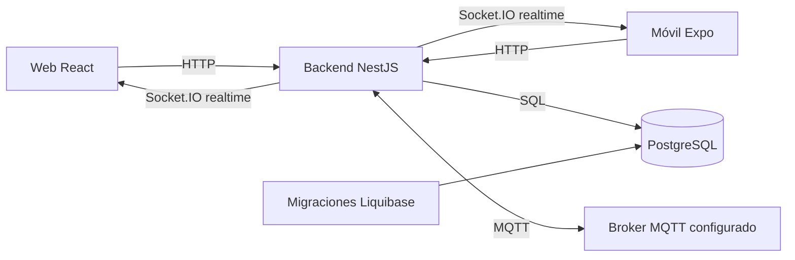

# Arquitectura general de SmartHome

## Implementación observada

El backend es una aplicación NestJS modular en un proceso Node.js: sirve HTTP y Socket.IO, accede a PostgreSQL y abre clientes MQTT. No se identificaron microservicios Nest independientes. Web y móvil consumen HTTP y eventos; no se verificó que esos clientes se conecten directamente al broker MQTT.

La base de datos mantiene DDL, DML, DCL, funciones de negocio y permisos. Las entidades y llamadas del backend dependen de ese esquema; Prisma no es la fuente de las migraciones SQL del ecosistema.

El diagrama representa dependencias observadas en código y configuración. No representa infraestructura activa, número de instancias ni garantías de entrega. El dispositivo físico y su firmware no se inspeccionaron como un repositorio adicional.

Fuentes: [HTTP y adaptador realtime](https://github.com/nataliachala1/smarthome-backend/blob/1cbaca28e9e152d5cb5ff7643560fdfa65857486/src/main.ts), [configuración MQTT](https://github.com/nataliachala1/smarthome-backend/blob/1cbaca28e9e152d5cb5ff7643560fdfa65857486/src/config/mqtt-config.ts), [servicios y dependencias](https://github.com/nataliachala1/smarthome-database/blob/6caed6bdfdcc89105a9f0e221e5b2dc8aad4d878/docker-compose.production.yml), [cliente web](https://github.com/nataliachala1/smarthome-frontend-web/blob/8dad6e1f805db958e1e650379ae1dd6cce3c4d57/web/src/shared/realtime/realtime-client.ts), [cliente móvil](https://github.com/Kevin-Stiven-Lopez-Amaya404/from_movil/blob/bb87f62c0727f22f376e56632c22bea66128a04a/lib/services/realtime-service.ts).

## Acuerdos y propuestas

No se encontraron ADR aceptados que acrediten aprobación global de esta topología. Las guías externas de diseño y despliegue son antecedentes pendientes de reconciliar. No se presenta Dokploy, un VPS o una estrategia de escalado como decisión aprobada o instalación operativa.

## Pendientes

Validar transporte y ACL del broker real, topología desplegada, consistencia de permisos SQL/realtime, disponibilidad y escalado del estado de sesiones en memoria. Ver [comunicaciones](comunicaciones-mqtt-realtime.md) y [evidencias](../00-contexto/evidencias-y-pendientes.md).
