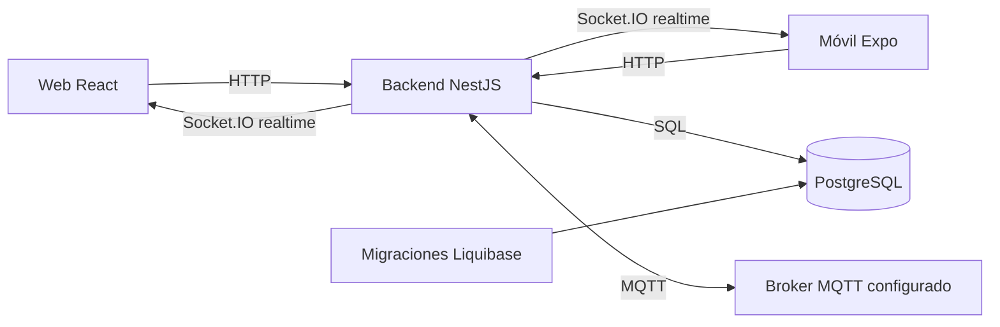

# Arquitectura general de SmartHome

## Implementación observada

El backend es una aplicación NestJS modular en un proceso Node.js: sirve HTTP y Socket.IO, accede a PostgreSQL y abre clientes MQTT. Incluye el módulo Energy para metas, tarifas y resúmenes de consumo. No se identificaron microservicios Nest independientes. Web y móvil consumen HTTP y eventos; no se verificó que esos clientes se conecten directamente al broker MQTT.

La base de datos mantiene DDL, DML, DCL, funciones de negocio y permisos. Las entidades y llamadas del backend dependen de ese esquema; Prisma no es la fuente de las migraciones SQL del ecosistema.

El diagrama representa dependencias observadas en código y configuración. El backend permite el flujo MQTT histórico de Mosquitto y un modo Flespi de un dispositivo, opt-in para DEV; este último usa PostgreSQL para deduplicar eventos. No representa infraestructura activa, número de instancias ni garantías de entrega. El dispositivo físico y su firmware no se inspeccionaron como un repositorio adicional.

Fuentes: [EnergyModule](https://github.com/nataliachala1/smarthome-backend/blob/60297c361e4acac6e98161337ef8e149e069d441/src/app.module.ts), [configuración MQTT actual](https://github.com/nataliachala1/smarthome-backend/blob/60297c361e4acac6e98161337ef8e149e069d441/src/config/mqtt-config.ts), [SQL035 de idempotencia](https://github.com/nataliachala1/smarthome-database/blob/3b20c9177a9aabfcc285043a6d85048bb1b95b7a/releases/035_flespi_mqtt_ingest_idempotency/001_mqtt_ingest_dedup.sql), [cliente web de energía](https://github.com/nataliachala1/smarthome-frontend-web/blob/7b9acdf12205cbc25aa3d0647cb9c60dbaaf17ac/web/src/shared/api/energy.api.ts), [cliente móvil en el último corte verificable](https://github.com/Kevin-Stiven-Lopez-Amaya404/from_movil/blob/bb87f62c0727f22f376e56632c22bea66128a04a/lib/services/realtime-service.ts).

## Acuerdos y propuestas

No se encontraron ADR aceptados que acrediten aprobación global de esta topología. Las guías externas de diseño y despliegue son antecedentes pendientes de reconciliar. No se presenta Dokploy, un VPS o una estrategia de escalado como decisión aprobada o instalación operativa.

## Pendientes

Validar transporte y ACL del broker real, topología desplegada, consistencia de permisos SQL/realtime, disponibilidad y escalado del estado de sesiones en memoria. Ver [comunicaciones](comunicaciones-mqtt-realtime.md) y [evidencias](../00-contexto/evidencias-y-pendientes.md).
