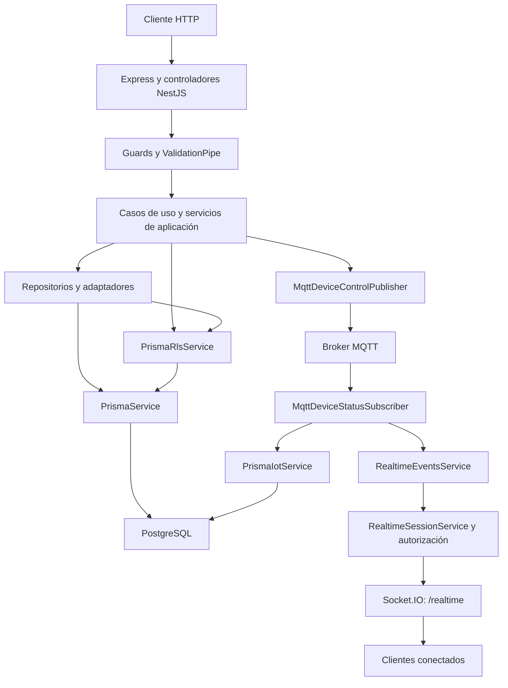

# Documentación técnica del backend SmartHome

> Referencia descriptiva de versión fija, incorporada a la central el 2026-10-29. Su autoridad técnica es el código enlazado, no esta copia. Para actualizarla se debe repetir el análisis sobre un commit identificado y revisar productores y consumidores. Las limitaciones de la inspección individual inicial se conservan como registro histórico; la revisión central posterior sí pudo comprobar el Git local y consultar SQL. Consulte [el resumen actual de alcance](../backend.md), [datos](../persistencia-y-datos.md) y [evidencias](../../00-contexto/evidencias-y-pendientes.md). No se ejecutaron aquí aplicaciones ni pruebas funcionales.

Documento obtenido mediante revisión estática del código, las configuraciones y el árbol de GitHub. Los ejemplos son ilustrativos: no proceden de solicitudes ejecutadas contra un servidor.

## Alcance y evidencia

- Repositorio: [nataliachala1/smarthome-backend](https://github.com/nataliachala1/smarthome-backend).
- Instantánea analizada: [dev, commit 1cbaca28e9e152d5cb5ff7643560fdfa65857486](https://github.com/nataliachala1/smarthome-backend/tree/1cbaca28e9e152d5cb5ff7643560fdfa65857486).
- La rama predeterminada `main`, commit `c2d41fcb28cd3a843038d64e1b689fd09ded2ec2`, contiene únicamente `README.md`. Se eligió `dev` porque contiene la implementación. No se considera esta selección una declaración de versión productiva o aprobada.
- Se enumeraron las ramas disponibles. Se recuperaron los 250 archivos de producción de `src/`, manifiesto y lockfile npm, configuración de compilación, Prisma, Docker y workflows; también pruebas y scripts pertinentes.
- No se utilizaron cuerpos, comentarios ni documentos adjuntos de Pull Requests como fuentes.
- La consola local no pudo iniciarse: `helper_unknown_error: setup refresh had errors`. No fue posible identificar el commit local, revisar modificaciones locales, compilar, arrancar la aplicación, generar OpenAPI ni ejecutar pruebas.
- Las definiciones SQL de funciones, políticas RLS y migraciones no están implementadas en este repositorio. Se describen sus invocaciones desde el backend; su existencia, permisos y comportamiento en una base instalada requieren contrastar `smarthome-database` y el entorno.
- El código permite describir comportamiento y condiciones; no prueba que PostgreSQL, MQTT, SMTP, certificados, imágenes o despliegues estén operativos.

## Índice

1. [Arquitectura y patrones](#1-arquitectura-y-patrones)
2. [Endpoints y contratos de API](#2-endpoints-y-contratos-de-api)
3. [Estructura de carpetas y archivos](#3-estructura-de-carpetas-y-archivos)
4. [Configuración en detalle](#4-configuracion-en-detalle)
5. [Inconsistencias, código sin uso y límites](#5-inconsistencias-codigo-sin-uso-y-limites)
6. [Comprobaciones realizadas](#6-comprobaciones-realizadas)

<a id="1-arquitectura-y-patrones"></a>

## 1. Arquitectura y patrones

### 1.1 Arquitectura observada

Es una aplicación NestJS modular que se ejecuta en un proceso Node.js. Expone HTTP mediante el adaptador Express y un gateway Socket.IO, abre clientes MQTT y conexiones PostgreSQL y ejecuta algunos trabajadores dentro del mismo proceso. No se encontraron servicios Nest separados mediante `@nestjs/microservices`.

Los módulos funcionales son `AuthModule`, `UsersModule`, `HomesModule`, `DevicesModule`, `ConsumptionModule`, `NotificationsModule` y `RealtimeModule`. `UsersModule` se incorpora a través de `AuthModule`; no figura como importación directa de `AppModule`. También existen `PrismaModule`, `HealthModule`, `RateLimitModule` y `SessionRevocationModule`.

Fuentes: [AppModule](https://github.com/nataliachala1/smarthome-backend/blob/1cbaca28e9e152d5cb5ff7643560fdfa65857486/src/app.module.ts), [AuthModule](https://github.com/nataliachala1/smarthome-backend/blob/1cbaca28e9e152d5cb5ff7643560fdfa65857486/src/modules/auth/auth.module.ts), [UsersModule](https://github.com/nataliachala1/smarthome-backend/blob/1cbaca28e9e152d5cb5ff7643560fdfa65857486/src/modules/users/users.module.ts), [DevicesModule](https://github.com/nataliachala1/smarthome-backend/blob/1cbaca28e9e152d5cb5ff7643560fdfa65857486/src/modules/devices/devices.module.ts), [package.json](https://github.com/nataliachala1/smarthome-backend/blob/1cbaca28e9e152d5cb5ff7643560fdfa65857486/package.json).



El diagrama representa dependencias y caminos de código. No representa una topología de producción verificada.

### 1.2 Patrones, ubicación y finalidad

La columna de finalidad explica la responsabilidad que se deduce del código; no atribuye una decisión arquitectónica formal al equipo.

| Patrón o mecanismo | Aplicación real | Finalidad deducida y límites |
| --- | --- | --- |
| Módulos por capacidad funcional | `src/modules/auth`, `users`, `homes`, `devices`, `consumption`, `notifications` y `realtime`; archivos `*.module.ts` | Agrupar controladores, providers y dependencias por función. Se despliegan juntos. |
| Capas de presentación, aplicación, dominio e infraestructura | `auth`, `users`, `homes` y `devices` contienen `presentation/`, `application/`, `domain/` e `infrastructure/` | Separar transporte HTTP, coordinación de operaciones, tipos/puertos y acceso externo. La separación no es uniforme en todos los módulos. |
| Puertos y adaptadores | Clases abstractas `UserRepository`, `UserPreferenceRepository`, `HomeRepository`, `HomeMemberRepository`, `DeviceRepository`, `RecoveryTokenRepository`, `RefreshTokenRepository`, `AccountActivationRepository`; `PasswordHasher`, `SecureToken`, `EmailSender`, `TokenService` y `DeviceControlPublisher` | Hacer que los casos de uso dependan de contratos sustituibles. Los módulos los enlazan a adaptadores Prisma, Argon2, Node, Gmail, JWT o MQTT. |
| Repository y mapeadores | `PrismaUserRepository` y `PrismaUserMapper`; equivalentes para hogares, miembros y dispositivos; mapeadores de tokens | Encapsular consultas y convertir nombres de BD como `id_device` a propiedades como `id`. Los repositorios son clases abstractas usadas como tokens de DI. |
| Casos de uso | `application/use-cases/*.use-case.ts` | Dar una operación explícita a registro, login, invitaciones, control y consultas. Algunos acceden directamente a Prisma o SQL. |
| Inyección de dependencias | `@Injectable`, constructores, `useClass` y `useFactory` de módulos | Enlazar implementaciones y elegir providers por configuración. Los gateways MQTT especializados utilizan también tokens `Symbol`. |
| Dependencia circular declarada | `forwardRef(() => UsersModule)` y `forwardRef(() => AuthModule)` | Resolver el ciclo real entre autenticación y usuarios. |
| Controladores y DTO | `presentation/http` o `presentation/controllers`; `application/dto` | Adaptar entradas HTTP a casos de uso. No se encontraron vistas renderizadas ni un MVC con plantillas de servidor. |
| Middleware de Express | `cookieParser()` y `helmet()` en `main.ts` | Leer la cookie de renovación y configurar cabeceras de seguridad. También se desactiva `x-powered-by`. |
| Validación y transformación | `ValidationPipe` global con `whitelist: true`, `forbidNonWhitelisted: true` y `transform: true`; decoradores `class-validator` y `class-transformer` | Rechazar propiedades ajenas al DTO y validar valores. No significa que todos los parámetros tengan conversión implícita; por ejemplo, `limit` usa `@Type(() => Number)`. |
| Guards | `JwtAuthGuard`, `HttpRateLimitGuard` y `ShellyLocalGuard` | Validar sesión, limitar solicitudes y bloquear herramientas LAN. `RolesGuard` existe como provider, pero no se aplica a los handlers inspeccionados. |
| Transacciones con contexto RLS | `PrismaRlsService.withUserContext` | Abrir `$transaction` y ejecutar `set_config('app.current_user_id', userId, true)`. El contexto es local a la transacción. Las políticas SQL reales no se pueden reconstruir únicamente desde el backend. |
| Clientes de BD separados | `PrismaService` y `PrismaIotService`; pools `pg` para métricas y pairing | Separar la conexión funcional de ingesta y de operaciones privilegiadas. Los gateways de pairing comprueban roles, destino y privilegios antes de operar. |
| Publicación/suscripción | `MqttDeviceControlPublisher`, `MqttDeviceStatusSubscriber` y `MqttTopicContract` | Enviar comandos y recibir estado/telemetría sin bloquear la API hasta que el equipo físico cambie de estado. `COMMAND_PUBLISHED` no confirma ejecución física. |
| Entrega de eventos por usuario | `RealtimeGateway`, `RealtimeEventsService` y `RealtimeSessionService` | Autenticar sockets y autorizar cada entrega. La entrega es best effort; no se encontró un outbox durable ni confirmación de recepción de eventos de aplicación. |
| Máquina de estados e idempotencia | `ShellyPairingSessionService`, coordinadores `shelly-mqtt-*.ts` y funciones SQL `devices.fn_*` | Mantener sesiones temporales, reintentos de creación por `requestId`, leases y confirmación de evidencia. Los resultados inciertos exigen reconciliación. |
| Cifrado de secreto de preparación | `EncryptedMqttPreparationSecretPort` y `ShellyMqttBootstrapAction` | Usar AES-256-GCM y entregar credenciales individuales solamente en una respuesta autorizada. La presencia del código no acredita validación física del flujo. |
| Tareas de ciclo de vida | `OnModuleInit`, `OnModuleDestroy` y `OnApplicationBootstrap` | Abrir/cerrar conexiones y temporizadores del watchdog, métricas, sesiones realtime y revocación MQTT. No son procesos externos independientes. |
| Traducción parcial de errores | `throwDeviceHttpError` y catches de controladores/casos de uso | Traducir errores conocidos a HTTP. No se encontró un filtro global que normalice todos los errores Prisma, SQL o de dominio. |

Fuentes principales: [PrismaRlsService](https://github.com/nataliachala1/smarthome-backend/blob/1cbaca28e9e152d5cb5ff7643560fdfa65857486/src/infrastructure/database/prisma/prisma-rls.service.ts), [AuthModule](https://github.com/nataliachala1/smarthome-backend/blob/1cbaca28e9e152d5cb5ff7643560fdfa65857486/src/modules/auth/auth.module.ts), [HomesModule](https://github.com/nataliachala1/smarthome-backend/blob/1cbaca28e9e152d5cb5ff7643560fdfa65857486/src/modules/homes/homes.module.ts), [DevicesModule](https://github.com/nataliachala1/smarthome-backend/blob/1cbaca28e9e152d5cb5ff7643560fdfa65857486/src/modules/devices/devices.module.ts), [RealtimeModule](https://github.com/nataliachala1/smarthome-backend/blob/1cbaca28e9e152d5cb5ff7643560fdfa65857486/src/modules/realtime/realtime.module.ts), [main.ts](https://github.com/nataliachala1/smarthome-backend/blob/1cbaca28e9e152d5cb5ff7643560fdfa65857486/src/main.ts), [traducción de errores de dispositivos](https://github.com/nataliachala1/smarthome-backend/blob/1cbaca28e9e152d5cb5ff7643560fdfa65857486/src/modules/devices/application/use-cases/device-http-error.ts).

La organización se parece a puertos y adaptadores, pero no es una arquitectura hexagonal estricta: `HomePermissionsService`, los casos de consumo y notificaciones y `ShellyPairingSessionService` importan Prisma/SQL directamente; varios casos de uso lanzan excepciones HTTP de NestJS. Las entidades son principalmente contenedores de datos y getters; no hay evidencia suficiente para afirmar un modelo DDD completo.

### 1.3 Autenticación, permisos y sesiones

- `JwtTokenService.generateAccessToken` firma claims `sub`, `role`, `sv` y `sid`. `JwtAuthGuard` verifica HS256, UUID de usuario y familia, versión de sesión, rol actual, cuenta `ACTIVE` y existencia de una familia activa de refresh tokens.
- El refresh token es un token opaco generado por `NodeSecureToken`, no un segundo JWT. Se conserva su hash y se rota dentro de una familia. La reutilización de un refresh revocado revoca la familia.
- El access token tiene vencimiento predeterminado de 15 minutos. La duración del refresh es `REFRESH_TOKEN_EXPIRES_DAYS`, predeterminada de 30 días.
- Login bloquea la cuenta durante 15 minutos al llegar a cinco intentos fallidos. Es un mecanismo distinto del límite HTTP por IP.
- `logout` revoca la familia indicada por cookie; `logout-all` incrementa `sessionVersion` y revoca todas las familias. La revocación local se publica mediante `SessionRevocationService`.
- Los permisos de hogar/dispositivo se consultan mediante funciones SQL y RLS. No deben confundirse roles globales del JWT con roles de hogar `OWNER`, `MEMBER` y `GUEST`.
- Las anotaciones Swagger que mencionan únicamente roles no describen por sí solas las excepciones por dispositivo o los permisos efectivos.

Fuentes: [JwtAuthGuard](https://github.com/nataliachala1/smarthome-backend/blob/1cbaca28e9e152d5cb5ff7643560fdfa65857486/src/modules/auth/presentation/http/guards/jwt-auth.guard.ts), [JWT](https://github.com/nataliachala1/smarthome-backend/blob/1cbaca28e9e152d5cb5ff7643560fdfa65857486/src/modules/auth/infrastructure/security/jwt-token.service.ts), [login](https://github.com/nataliachala1/smarthome-backend/blob/1cbaca28e9e152d5cb5ff7643560fdfa65857486/src/modules/auth/application/use-cases/login-user.use-case.ts), [refresh](https://github.com/nataliachala1/smarthome-backend/blob/1cbaca28e9e152d5cb5ff7643560fdfa65857486/src/modules/auth/application/use-cases/refresh-session.use-case.ts), [HomePermissionsService](https://github.com/nataliachala1/smarthome-backend/blob/1cbaca28e9e152d5cb5ff7643560fdfa65857486/src/modules/homes/application/services/home-permissions.service.ts), [PrismaDeviceRepository](https://github.com/nataliachala1/smarthome-backend/blob/1cbaca28e9e152d5cb5ff7643560fdfa65857486/src/modules/devices/infrastructure/persistence/prisma-device.repository.ts).

### 1.4 MQTT, persistencia y trabajadores

`MqttTopicContract` deriva los tópicos. Para un identificador `d`:

| Tráfico | Sin namespace | Con namespace `n` |
| --- | --- | --- |
| Control interno | `smarthome/devices/d/control`, salvo prefijo heredado válido | `n/devices/d/control` |
| Estado interno | `smarthome/devices/+/status`, salvo prefijo heredado válido | `n/devices/+/status` |
| RPC Shelly | `d/rpc` | `n/devices/d/rpc` |
| Estado de switch Shelly | `+/status/switch:0` con switch predeterminado | `n/devices/+/status/switch:0` |
| Eventos Shelly | `+/events/rpc` | `n/devices/+/events/rpc` |

El switch puede configurarse. El ID se valida con `mqttDeviceId`. El comando interno contiene `command`, `homeId`, `deviceId`, `manufacturerDeviceId` y `sentAt`. Un identificador que empieza por `shelly` utiliza RPC `Switch.Set` con `params.id` y `params.on`. La publicación usa QoS 1 y `retain: false`.

El suscriptor valida JSON, identifica un dispositivo activo por `manufacturer_device_id` y actualiza estado y `last_seen_at`. Si llega `currentPowerW` numérico, intenta insertar consumo. Convierte la energía Shelly `aenergy.total` de Wh a kWh. Puede deducir el delta a partir del contador anterior.

**La actualización de estado y la inserción de consumo no comparten una única transacción.** Si falla el guardado de consumo, el estado ya actualizado puede conservarse y emitirse. Los eventos de consumo se emiten cuando esa inserción termina; la entrega puede fallar sin deshacer la BD.

`ConsumptionDailyMetricsWorker` se activa por flag, usa una conexión propia, recalcula al iniciar con `daysBack=7` y después cada 60 segundos con `daysBack=1`. Los endpoints de resumen consultan lecturas crudas, no dependen de este worker.

`DeviceOfflineWatcherService` comprueba por defecto cada 30 segundos dispositivos que llevan más de 60 segundos sin verse; los marca `OFFLINE` y emite estado. El bucle de revocación MQTT condicional usa un intervalo de cinco segundos. El worker de autenticación MQTT se dispara mediante el flujo autorizado; no tiene un temporizador automático equivalente.

Fuentes: [tópicos](https://github.com/nataliachala1/smarthome-backend/blob/1cbaca28e9e152d5cb5ff7643560fdfa65857486/src/modules/devices/infrastructure/messaging/mqtt-topic-contract.ts), [publicador](https://github.com/nataliachala1/smarthome-backend/blob/1cbaca28e9e152d5cb5ff7643560fdfa65857486/src/modules/devices/infrastructure/messaging/mqtt-device-control.publisher.ts), [suscriptor](https://github.com/nataliachala1/smarthome-backend/blob/1cbaca28e9e152d5cb5ff7643560fdfa65857486/src/modules/devices/infrastructure/messaging/mqtt-device-status.subscriber.ts), [métricas](https://github.com/nataliachala1/smarthome-backend/blob/1cbaca28e9e152d5cb5ff7643560fdfa65857486/src/modules/consumption/infrastructure/workers/consumption-daily-metrics.worker.ts), [watchdog](https://github.com/nataliachala1/smarthome-backend/blob/1cbaca28e9e152d5cb5ff7643560fdfa65857486/src/modules/devices/infrastructure/watchers/device-offline-watcher.service.ts), [providers de revocación](https://github.com/nataliachala1/smarthome-backend/blob/1cbaca28e9e152d5cb5ff7643560fdfa65857486/src/modules/devices/infrastructure/messaging/shelly-mqtt-revocation.providers.ts).

### 1.5 Tiempo real

El gateway usa el namespace Socket.IO `/realtime`. No es una API de WebSocket JSON sin protocolo Socket.IO. Se autentica con `handshake.auth.token` o con `Authorization: Bearer …` del handshake; no se encontró autenticación mediante query string.

Al conectar emite `realtime.connected` con `{ userId }`. Se revalidan conexiones cada 15 segundos, antes de entregas y al registrar; también se programa el vencimiento del token. Ante error emite `realtime.error` con `{ code, message }` y desconecta. Los códigos definidos son `REALTIME_UNAUTHORIZED`, `REALTIME_TOKEN_EXPIRED`, `REALTIME_SESSION_REVOKED` y `REALTIME_UNAVAILABLE`.

| Evento de aplicación | Productor efectivo o situación | Contenido principal |
| --- | --- | --- |
| `device.status.updated` | Suscriptor MQTT y watchdog | `id, homeId, connectivityStatus, isOn, currentPowerW, updatedAt` |
| `consumption.created` | Suscriptor tras guardar la lectura | `id, homeId, deviceId, deviceName, manufacturerDeviceId, powerW, energyDeltaKwh, energyTotalKwh, voltageV, currentA, frequencyHz, temperatureC, readAt` |
| `notification.unread_count.updated` | Actualización individual o masiva de notificaciones | `unreadCount` |
| `notification.created` | Existe código de emisión, pero el flujo actual de ingesta no llena la lista `notifications` | Contrato potencial definido en el suscriptor; no se documenta generación automática activa de alertas. |

`RealtimeAccessService` exige para eventos de hogar membresía activa `OWNER` o `MEMBER`, `accepted_at` informado, `ended_at` nulo y hogar activo sin eliminación. Esto no replica exactamente las funciones de permisos HTTP. El contador de notificaciones tiene una validación específica.

Sesiones, revocaciones y contador de rate limit se guardan en memoria del proceso. No se encontró adaptador Socket.IO compartido ni bus de revocación entre réplicas en esta instantánea.

Fuentes: [gateway](https://github.com/nataliachala1/smarthome-backend/blob/1cbaca28e9e152d5cb5ff7643560fdfa65857486/src/modules/realtime/realtime.gateway.ts), [sesiones](https://github.com/nataliachala1/smarthome-backend/blob/1cbaca28e9e152d5cb5ff7643560fdfa65857486/src/modules/realtime/realtime-session.service.ts), [autorización](https://github.com/nataliachala1/smarthome-backend/blob/1cbaca28e9e152d5cb5ff7643560fdfa65857486/src/modules/realtime/realtime-access.service.ts), [entrega](https://github.com/nataliachala1/smarthome-backend/blob/1cbaca28e9e152d5cb5ff7643560fdfa65857486/src/modules/realtime/realtime-events.service.ts), [adaptador](https://github.com/nataliachala1/smarthome-backend/blob/1cbaca28e9e152d5cb5ff7643560fdfa65857486/src/modules/realtime/secure-io.adapter.ts).

<a id="2-endpoints-y-contratos-de-api"></a>

## 2. Endpoints y contratos de API

### 2.1 Reglas comunes y alcance del inventario

Se identificaron **67 handlers HTTP de registro ordinario y cuatro handlers MQTT condicionales**. `AppController.getHello` declara un `GET /` adicional, pero `AppController` y `AppService` no están registrados en `AppModule`: no se incluye como endpoint operativo.

Las rutas incluyen literalmente `api/v1` en sus decoradores; no hay `setGlobalPrefix`. Salud usa `/health`. Swagger se configura en `/api/docs` cuando está habilitado, mediante `SwaggerModule.createDocument`; no hay un `openapi.json` versionado ni se generó uno durante este análisis. Las rutas auxiliares del middleware Swagger no se cuentan como handlers propios del backend.

Convenciones para las tablas:

- `—` significa que el handler no declara ese tipo de entrada.
- Todo cuerpo documentado es JSON; enviar `Content-Type: application/json`.
- `JWT` significa `Authorization: Bearer <accessToken>`. No basta la cookie de refresh para las rutas protegidas.
- Los parámetros `homeId`, `deviceId`, `sessionId`, `memberId` y `notificationId` son UUID. Hogares, invitaciones y permisos especifican UUID v4; dispositivos, consumo y Shelly usan `ParseUUIDPipe` sin versión explícita.
- Las fechas `Date` de los objetos de retorno se serializan como cadenas ISO; los datos opcionales se señalan como `null` cuando el código los devuelve así.
- Salvo `/health/live`, el guard global puede devolver `429`. Los handlers protegidos pueden devolver `401`. Parámetros/DTO inválidos producen `400` cuando tienen pipes/validadores.
- Todos pueden acabar en `500` por errores no traducidos. Las tablas destacan errores específicos, no prometen traducir cualquier error SQL a un estado de negocio.
- Un decorador Swagger `@ApiOkResponse` no modifica el status de ejecución. Los `POST` conservan `201` salvo `@HttpCode` explícito.

#### Cabeceras y cookie

La cookie `refresh_token` se crea en login y se rota en refresh. Tiene `httpOnly: true`, `path: '/api/v1/auth'`, expiración de la familia y opciones `secure`, `sameSite` y `domain` configurables. Los cuerpos JSON no incluyen el refresh token. Logout y logout-all limpian la cookie.

CORS permite `Content-Type`, `Authorization` y `X-Pairing-Token`; expone `Retry-After` y habilita credenciales. No incluye `X-SmartHome-Lab-Network-Approval` en `allowedHeaders`. CORS no sustituye la autorización JWT.

#### Rate limit

Los límites son por IP y handler, con ventanas y bloqueo de 60 segundos:

| Grupo | Solicitudes |
| --- | ---: |
| API por defecto | 120 |
| Login | 10 |
| Register, resend-activation, forgot-password y request-reactivation | 5 |
| Activate, reset-password y reactivate | 10 |
| Refresh | 30 |
| Change-password | 5 |

Al excederse se devuelve `429`, cabecera `Retry-After` y un cuerpo como:

```json
{
  "statusCode": 429,
  "code": "RATE_LIMIT_EXCEEDED",
  "message": "Demasiadas solicitudes. Intenta nuevamente más tarde.",
  "retryAfterSeconds": 60
}
```

El valor de `retryAfterSeconds` es variable. El almacenamiento es local y está limitado a 10 000 contadores.

Fuentes: [main.ts](https://github.com/nataliachala1/smarthome-backend/blob/1cbaca28e9e152d5cb5ff7643560fdfa65857486/src/main.ts), [rate-limit.policy.ts](https://github.com/nataliachala1/smarthome-backend/blob/1cbaca28e9e152d5cb5ff7643560fdfa65857486/src/security/rate-limit.policy.ts), [HttpRateLimitGuard](https://github.com/nataliachala1/smarthome-backend/blob/1cbaca28e9e152d5cb5ff7643560fdfa65857486/src/security/http-rate-limit.guard.ts), [MemoryRateLimitStorage](https://github.com/nataliachala1/smarthome-backend/blob/1cbaca28e9e152d5cb5ff7643560fdfa65857486/src/security/memory-rate-limit.storage.ts), [AuthController](https://github.com/nataliachala1/smarthome-backend/blob/1cbaca28e9e152d5cb5ff7643560fdfa65857486/src/modules/auth/presentation/http/auth.controller.ts).

### 2.2 Autenticación

Sin path ni query parameters en este grupo. Los cuerpos se describen después de la tabla.

| Método y ruta | Autenticación y body | Respuesta de éxito | Errores/efecto verificable |
| --- | --- | --- | --- |
| `GET /api/v1/auth/me` | JWT; body — | `200 { userId, role }` | `401` por sesión inválida. Devuelve la identidad del guard, no el perfil completo. |
| `POST /api/v1/auth/register` | Pública; `RegisterUserDto` | `201 { id, name, email, status, emailVerified }` | `400` por confirmación distinta; `409` correo existente; `503` si no está habilitado el correo. Crea usuario y token antes de enviar email. |
| `POST /api/v1/auth/activate` | Pública; `ActivateAccountDto` | `201 { activated: true }` | `400` token inválido/expirado/no utilizable. Activa mediante repositorio. |
| `POST /api/v1/auth/resend-activation` | Pública; `ResendActivationDto` | `201 { sent: true }` | Respuesta genérica si no hay usuario pendiente. Si intenta enviar correo, puede responder `503` por correo deshabilitado. |
| `POST /api/v1/auth/forgot-password` | Pública; `ForgotPasswordDto` | `201 { sent: true }` | Respuesta genérica si cuenta inexistente, pendiente o desactivada. `503` si corresponde envío y está deshabilitado. |
| `POST /api/v1/auth/reset-password` | Pública; `ResetPasswordDto` | `201 { reset: true }` | `400` token inválido o contraseñas distintas. Actualiza password, consume token e invalida sesiones. |
| `PATCH /api/v1/auth/change-password` | JWT; `ChangePasswordDto` | `200 { changed: true }` | `400` password actual incorrecta o confirmación distinta. Invalida sesiones. Un `InvalidCredentialsError` por una carrera de eliminación no tiene traducción explícita aquí. |
| `POST /api/v1/auth/login` | Pública; `LoginDto` | `201 { accessToken, tokenType: "Bearer", user: { id, name, email, role } }` y `Set-Cookie` | `401` credenciales inválidas; `403` cuenta no activa/bloqueada. |
| `POST /api/v1/auth/refresh` | Cookie `refresh_token`; body — | `201 { accessToken, tokenType: "Bearer" }` y cookie rotada | `401` cookie ausente, expiración, revocación o reuso. Limpia cookie ante `InvalidRefreshTokenError`. |
| `POST /api/v1/auth/logout` | Cookie opcional; body — | `200 { message: "Sesión cerrada correctamente" }` | Idempotente sin cookie o con token desconocido. Revoca la familia si puede identificarla. |
| `POST /api/v1/auth/logout-all` | JWT; body — | `200 { message: "Todas las sesiones fueron cerradas correctamente" }` | `404` si el usuario desaparece después de autenticarse. Incrementa versión y revoca todas las familias. |
| `POST /api/v1/auth/request-reactivation` | Pública; `RequestReactivationDto` | `201 { sent: true }` | Respuesta genérica salvo envío efectivo; `503` si correo deshabilitado. Solo solicita token para cuenta desactivada. |
| `POST /api/v1/auth/reactivate` | Pública; `ReactivateAccountDto` | `201 { reactivated: true }` | `400` token inválido o cuenta que ya no está desactivada. |

#### Cuerpos de autenticación

| DTO real | Campos y validaciones |
| --- | --- |
| `RegisterUserDto` | `name` string no vacío, máximo 100; `email` email no vacío, máximo 255; `password` string de al menos 8, con mayúscula, número y carácter no alfanumérico; `passwordConfirmation` string no vacío. El caso de uso compara ambas, recorta nombre y normaliza correo. |
| `ActivateAccountDto`, `ReactivateAccountDto` | `token` string no vacío. |
| `LoginDto` | `email` email no vacío; `password` string no vacío. |
| `ResendActivationDto`, `RequestReactivationDto` | `email` email no vacío. |
| `ForgotPasswordDto` | `email` email no vacío, máximo 255. |
| `ResetPasswordDto` | `token` no vacío; `password` con política de registro; `passwordConfirmation` no vacío y coincidente. |
| `ChangePasswordDto` | `currentPassword` no vacío; `newPassword` con política de registro; `newPasswordConfirmation` no vacío y coincidente. |

Los tokens de activación, recuperación y reactivación tienen un vencimiento de 30 minutos fijado en los casos de uso. Los envíos genéricos no prueban entrega real de correo.

Fuentes: [AuthController](https://github.com/nataliachala1/smarthome-backend/blob/1cbaca28e9e152d5cb5ff7643560fdfa65857486/src/modules/auth/presentation/http/auth.controller.ts), [DTO de registro](https://github.com/nataliachala1/smarthome-backend/blob/1cbaca28e9e152d5cb5ff7643560fdfa65857486/src/modules/auth/application/dto/register-user.dto.ts), [registro](https://github.com/nataliachala1/smarthome-backend/blob/1cbaca28e9e152d5cb5ff7643560fdfa65857486/src/modules/auth/application/use-cases/register-user.use-case.ts), [activación](https://github.com/nataliachala1/smarthome-backend/blob/1cbaca28e9e152d5cb5ff7643560fdfa65857486/src/modules/auth/application/use-cases/activate-account.use-case.ts), [recuperación](https://github.com/nataliachala1/smarthome-backend/blob/1cbaca28e9e152d5cb5ff7643560fdfa65857486/src/modules/auth/application/use-cases/forgot-password.use-case.ts), [cambio de contraseña](https://github.com/nataliachala1/smarthome-backend/blob/1cbaca28e9e152d5cb5ff7643560fdfa65857486/src/modules/auth/application/use-cases/change-password.use-case.ts), [restablecimiento](https://github.com/nataliachala1/smarthome-backend/blob/1cbaca28e9e152d5cb5ff7643560fdfa65857486/src/modules/auth/application/use-cases/reset-password.use-case.ts), [reactivación](https://github.com/nataliachala1/smarthome-backend/blob/1cbaca28e9e152d5cb5ff7643560fdfa65857486/src/modules/auth/application/use-cases/reactivate-account.use-case.ts).

### 2.3 Usuarios y preferencias

Todas las rutas requieren JWT. No declaran path ni query parameters.

| Método y ruta | Body | Respuesta de éxito | Errores/efecto |
| --- | --- | --- | --- |
| `GET /api/v1/users/me` | — | `200` perfil | `404` si el usuario desaparece. |
| `PATCH /api/v1/users/me` | `UpdateMyProfileDto`: `name?` string, 2–100 caracteres | `200` perfil actualizado | `400` DTO; `404` usuario. |
| `GET /api/v1/users/me/preferences` | — | `200` preferencias | Crea valores iniciales si no existen mediante `upsert`. |
| `PATCH /api/v1/users/me/preferences` | `UpdateMyPreferencesDto` | `200` preferencias | `400` DTO; los errores de restricciones SQL no tienen mapeo específico. |
| `PATCH /api/v1/users/me/deactivate` | `DeactivateMyAccountDto`: `confirm: true` | `200 { message, status: "DEACTIVATED", deactivatedAt }` | `400` sin confirmación; `404` usuario; `409` si la cuenta no está activa. |

Perfil: `{ id, name, email, role, status, emailVerified, createdAt, updatedAt }`.

Preferencias: `{ userId, language, theme, dateFormat, timeFormat, timezone }`. Los campos actualizables son opcionales:

- `language`: `es | en | fr | de`.
- `theme`: `claro | oscuro | automatico`.
- `dateFormat`: `DD/MM/YYYY | MM/DD/YYYY | YYYY-MM-DD`, máximo 20.
- `timeFormat`: `12h | 24h`.
- `timezone`: string de hasta 80 con forma de ruta IANA. La expresión regular comprueba la forma, no la existencia de la zona.

Valores iniciales del repositorio: `es`, `claro`, `DD/MM/YYYY`, `24h`, `America/Bogota`. La BD guarda también `currency` y `temperature_unit`, pero estos campos no se exponen en este API.

Fuentes: [UsersController](https://github.com/nataliachala1/smarthome-backend/blob/1cbaca28e9e152d5cb5ff7643560fdfa65857486/src/modules/users/presentation/http/users.controller.ts), [DTO de preferencias](https://github.com/nataliachala1/smarthome-backend/blob/1cbaca28e9e152d5cb5ff7643560fdfa65857486/src/modules/users/application/dto/update-my-preferences.dto.ts), [repositorio de preferencias](https://github.com/nataliachala1/smarthome-backend/blob/1cbaca28e9e152d5cb5ff7643560fdfa65857486/src/modules/users/infrastructure/persistence/prisma-user-preference.repository.ts), [desactivación](https://github.com/nataliachala1/smarthome-backend/blob/1cbaca28e9e152d5cb5ff7643560fdfa65857486/src/modules/users/application/use-cases/deactivate-my-account.use-case.ts).

### 2.4 Hogares, miembros e invitaciones

Todas requieren JWT; no declaran query parameters. Los identificadores de este grupo se validan como UUID v4. `memberId` identifica una fila de membresía/invitación, no el UUID del usuario.

Objeto hogar: `{ id, createdBy, name, status, createdAt, updatedAt }`.

| Método y ruta | Entrada | Respuesta de éxito | Errores/efecto |
| --- | --- | --- | --- |
| `GET /api/v1/homes` | Body — | `200` array de hogares | El repositorio filtra membresía propia `ACTIVE`, hogar `ACTIVE` y `deleted_at: null`. |
| `POST /api/v1/homes` | `CreateHomeDto`: `name` no vacío, máximo 100 | `201` hogar | Crea hogar y membresía `OWNER/ACTIVE` en la misma transacción. Las violaciones de unicidad SQL no se traducen específicamente a 409. |
| `GET /api/v1/homes/:homeId` | Path `homeId`; body — | `200` hogar | `404` si no hay fila visible. La visibilidad depende también de RLS. |
| `PATCH /api/v1/homes/:homeId` | Path `homeId`; `UpdateHomeDto`: `name?` string máximo 100 | `200` hogar | `404` no visible; `403` si el repositorio traduce denegación en `HomeAccessDeniedError`. |
| `DELETE /api/v1/homes/:homeId` | Path `homeId`; body — | `200 { deleted: true }` | `404` acceso denegado/no encontrado; `409` si existe cualquier dispositivo. Hace eliminación lógica. |
| `GET /api/v1/homes/:homeId/members` | Path `homeId`; body — | `200` array de miembros | Las filas visibles quedan sujetas a RLS. |
| `POST /api/v1/homes/:homeId/invitations` | Path `homeId`; `CreateHomeInvitationDto`: `email` válido, `role`: `MEMBER` o `GUEST` | `201` invitación creada | `404` correo sin usuario; `400` usuario no activo/autoinvitación; `409` Prisma `P2002`. Otras denegaciones SQL no tienen traducción específica. |
| `PATCH /api/v1/homes/:homeId/members/:memberId/role` | Paths; `UpdateHomeMemberRoleDto`: `role`: `MEMBER` o `GUEST` | `200` miembro actualizado | `404` membresía no visible; `409` si rol/estado actual no admite cambio. |
| `PATCH /api/v1/homes/:homeId/members/:memberId/revoke` | Paths; body — | `200` miembro revocado | `409` `MEMBERSHIP_NOT_REVOCABLE`. Solo busca miembros `MEMBER/GUEST` en `PENDING/ACTIVE`. |
| `PATCH /api/v1/homes/:homeId/members/me/leave` | Path `homeId`; body — | `200` membresía con `status: LEFT` | `409` si no existe membresía propia activa `MEMBER/GUEST` abandonable. |
| `GET /api/v1/invitations` | Body — | `200` array de invitaciones propias `PENDING` | Filtra `id_user` del autenticado. |
| `PATCH /api/v1/invitations/:memberId/accept` | Path `memberId`; body — | `200 { id, homeId, role, status, acceptedAt }` | `404` invitación ajena/invisible; `409` si ya no está `PENDING`. Pasa a `ACTIVE`. |
| `PATCH /api/v1/invitations/:memberId/reject` | Path `memberId`; body — | `200 { id, homeId, role, status, endedAt }` | `404` invitación ajena/invisible; `409` no pendiente. Pasa a `LEFT`. |

En invitaciones y cambios de rol solo se aceptan las cadenas `MEMBER` y `GUEST`.

Formas de respuesta de miembros:

- Listado: `id, homeId, userId, role, status, invitedBy, invitedAt, acceptedAt, endedAt, createdAt, updatedAt`.
- Invitación creada: `id, homeId, userId, role, status, invitedBy, invitedAt`.
- Invitación listada: `id, homeId, role, status, invitedBy, invitedAt`.
- Cambio de rol/revocación: `id, homeId, userId, role, status, acceptedAt, endedAt, updatedAt`.
- Abandono: `id, homeId, role, status, acceptedAt, endedAt`.

No se observa un guard OWNER explícito en cada handler de miembros: parte de la autorización se delega a las políticas SQL. No se garantiza un `403` uniforme para todas las denegaciones. El borrado de hogar cuenta también los dispositivos lógicamente eliminados, porque su `count` no filtra `deleted_at`.

Fuentes: [HomesController](https://github.com/nataliachala1/smarthome-backend/blob/1cbaca28e9e152d5cb5ff7643560fdfa65857486/src/modules/homes/presentation/http/homes.controller.ts), [InvitationsController](https://github.com/nataliachala1/smarthome-backend/blob/1cbaca28e9e152d5cb5ff7643560fdfa65857486/src/modules/homes/presentation/http/invitations.controller.ts), [PrismaHomeRepository](https://github.com/nataliachala1/smarthome-backend/blob/1cbaca28e9e152d5cb5ff7643560fdfa65857486/src/modules/homes/infrastructure/persistence/prisma-home.repository.ts), [PrismaHomeMemberRepository](https://github.com/nataliachala1/smarthome-backend/blob/1cbaca28e9e152d5cb5ff7643560fdfa65857486/src/modules/homes/infrastructure/persistence/prisma-home-member.repository.ts), [creación de invitación](https://github.com/nataliachala1/smarthome-backend/blob/1cbaca28e9e152d5cb5ff7643560fdfa65857486/src/modules/homes/application/use-cases/create-home-invitation.use-case.ts).

### 2.5 Permisos de hogar y dispositivo

JWT obligatorio. Paths UUID v4; query —. `HomePermissionsService.requireOwner` consulta `homes.fn_can_manage_home` y devuelve `403` si no permite gestionar el hogar.

| Método y ruta | Body | Respuesta de éxito | Errores específicos |
| --- | --- | --- | --- |
| `GET /api/v1/homes/:homeId/members/:memberId/permissions` | — | `200 { canViewDevices, canViewConsumption, canControlDevices }`, booleanos | `403` gestión no permitida; `404` membresía. |
| `PUT /api/v1/homes/:homeId/members/:memberId/permissions` | `SetHomeMemberPermissionsDto` con los tres booleanos requeridos de la respuesta | `200` permisos guardados | `400` DTO; `403`; `404`. |
| `GET /api/v1/homes/:homeId/members/:memberId/devices/:deviceId/permissions` | — | `200 { canViewDevice, canViewConsumption, canControlDevice }`, booleano o null | `403`; `404` membresía/dispositivo. |
| `PUT /api/v1/homes/:homeId/members/:memberId/devices/:deviceId/permissions` | `SetDevicePermissionsDto`: uno o más de los tres campos, booleano o null | `200` permisos guardados | `400` si no se indica ningún permiso o DTO inválido; `403`; `404`. |

En excepciones por dispositivo, omitir una propiedad conserva su valor; enviar `null` solicita herencia. Las funciones SQL efectivas son `homes.fn_get_member_permissions`, `fn_set_member_permissions`, `fn_get_device_permissions` y `fn_set_device_permissions`.

Fuente: [HomePermissionsController](https://github.com/nataliachala1/smarthome-backend/blob/1cbaca28e9e152d5cb5ff7643560fdfa65857486/src/modules/homes/presentation/http/home-permissions.controller.ts), [servicio](https://github.com/nataliachala1/smarthome-backend/blob/1cbaca28e9e152d5cb5ff7643560fdfa65857486/src/modules/homes/application/services/home-permissions.service.ts), [DTO por dispositivo](https://github.com/nataliachala1/smarthome-backend/blob/1cbaca28e9e152d5cb5ff7643560fdfa65857486/src/modules/homes/application/dto/set-device-permissions.dto.ts).

### 2.6 Dispositivos

JWT obligatorio; paths `homeId` y `deviceId` UUID; query —.

Objeto de respuesta habitual: `{ id, homeId, name, status, connectivityStatus, isOn, currentPowerW, manufacturerDeviceId, transportType, messagingProtocol, createdAt, updatedAt }`. Los campos de telemetría/identificación/configuración pueden ser `null` según la fila.

| Método y ruta | Body | Respuesta de éxito | Errores/efecto |
| --- | --- | --- | --- |
| `GET /api/v1/homes/:homeId/devices` | — | `200` array de objetos habituales | `403` sin acceso al hogar. Filtra `ACTIVE` y no eliminados; orden por nombre. `currentPowerW` se oculta como null sin permiso detallado. |
| `GET /api/v1/homes/:homeId/devices/inactive` | — | `200` array de instancias `Device` | `403` sin gestión. Filtra `DEACTIVATED` con `deleted_at: null`. Véase advertencia de serialización debajo. |
| `GET /api/v1/homes/:homeId/devices/:deviceId` | — | `200` objeto habitual | `403` sin acceso; `404` sin dispositivo visible. OWNER puede consultar inactivos no eliminados; otros solo activos. Oculta potencia sin permiso. |
| `POST /api/v1/homes/:homeId/devices` | `CreateDeviceDto` | `201` objeto habitual | `403` gestión; `409` duplicado; `400` referencia inválida/DTO. Crea `ACTIVE/OFFLINE`, apagado y potencia null. |
| `PATCH /api/v1/homes/:homeId/devices/:deviceId` | `UpdateDeviceDto` | `200` objeto habitual | `403` acceso/dispositivo inexistente según traducción; `409` conflicto; `400` referencia/DTO. |
| `PATCH /api/v1/homes/:homeId/devices/:deviceId/activate` | — | `200` objeto habitual | `403` acceso o referencia no gestionable; `409` conflicto. Pasa a `ACTIVE/OFFLINE` y apagado; no conecta físicamente el equipo. |
| `PATCH /api/v1/homes/:homeId/devices/:deviceId/deactivate` | — | `200` objeto habitual | `403`; `409` conflicto. Pasa a `DEACTIVATED/OFFLINE`, apagado, sin `deleted_at`. |
| `PATCH /api/v1/homes/:homeId/devices/:deviceId/control` | `ControlDeviceDto`: `command: TURN_ON` o `TURN_OFF` | `200 { id, command, status: "COMMAND_PUBLISHED" }` | `403` sin permiso de control; `409` dispositivo no controlable/offline/sin MQTT/publicador no disponible; `400` DTO/referencia. |
| `DELETE /api/v1/homes/:homeId/devices/:deviceId` | — | `200 { message: "Dispositivo eliminado correctamente" }` | `403`; `409` conflicto. Marca `deleted_at`, `DEACTIVATED`, `OFFLINE` y apagado. |

`CreateDeviceDto` requiere `name` string recortado de 1–100. Opcionales: `manufacturerDeviceId` string máximo 100, `transportType` `WIFI` o `BLUETOOTH` y `messagingProtocol` `MQTT`. Ausentes se guardan como null. `UpdateDeviceDto` permite `name`, `transportType` y `messagingProtocol` opcionales, con las mismas restricciones; no modifica `manufacturerDeviceId`.

La traducción de `P2002` es `409`; `P2003` es `400`; denegación PostgreSQL y `P2025` se traducen a `403`. Control consulta `devices.fn_has_device_permission` y `devices.fn_device_control_target`; las anotaciones de roles de Swagger son menos precisas que estas funciones.

**Listado inactivo:** `ListInactiveDevicesUseCase` retorna las entidades sin mapear, mientras las otras rutas construyen objetos planos. `Device` contiene un campo privado TypeScript `props` y getters, sin `toJSON` ni serializador registrado. La serialización estándar previsiblemente produce `[{ "props": { ... } }]`, incluido `deletedAt`, en lugar del contrato plano. Es una deducción estática pendiente de comprobar mediante una solicitud real.

Fuentes: [DevicesController](https://github.com/nataliachala1/smarthome-backend/blob/1cbaca28e9e152d5cb5ff7643560fdfa65857486/src/modules/devices/presentation/controllers/devices.controller.ts), [PrismaDeviceRepository](https://github.com/nataliachala1/smarthome-backend/blob/1cbaca28e9e152d5cb5ff7643560fdfa65857486/src/modules/devices/infrastructure/persistence/prisma-device.repository.ts), [control](https://github.com/nataliachala1/smarthome-backend/blob/1cbaca28e9e152d5cb5ff7643560fdfa65857486/src/modules/devices/application/use-cases/control-device.use-case.ts), [listado inactivo](https://github.com/nataliachala1/smarthome-backend/blob/1cbaca28e9e152d5cb5ff7643560fdfa65857486/src/modules/devices/application/use-cases/list-inactive-devices.use-case.ts), [Device](https://github.com/nataliachala1/smarthome-backend/blob/1cbaca28e9e152d5cb5ff7643560fdfa65857486/src/modules/devices/domain/entities/device.entity.ts).

### 2.7 Notificaciones

JWT obligatorio. `notificationId` UUID. Solo el listado declara query parameters: `status?` en `UNREAD, READ, DISMISSED` y `limit?` entero de 1–100, convertido a número, predeterminado 20. No hay cursor ni offset.

Objeto notificación: `{ id, userId, alertId, homeId, homeName, deviceId, deviceName, manufacturerDeviceId, type, title, message, status, priority, channel, createdAt, updatedAt }`. Los enlaces opcionales pueden ser null.

| Método y ruta | Entradas | Respuesta de éxito | Errores/efecto |
| --- | --- | --- | --- |
| `GET /api/v1/notifications` | Query `status?, limit?`; body — | `200` array de notificaciones propias, más recientes primero | `400` query inválida. |
| `GET /api/v1/notifications/unread-count` | Query/body — | `200 { unreadCount }` | Cuenta propias `UNREAD`. |
| `PATCH /api/v1/notifications/read-all` | Query/body — | `200 { updatedCount }` | Cambia propias `UNREAD` a `READ` y emite contador después de transacción. |
| `PATCH /api/v1/notifications/:notificationId/read` | Path; body — | `200` objeto notificación actualizado | `404` fila ajena/no encontrada. Asigna `READ`. |
| `PATCH /api/v1/notifications/:notificationId/dismiss` | Path; body — | `200` objeto notificación actualizado | `404` fila ajena/no encontrada. Asigna `DISMISSED`. |

No hay un endpoint de creación de notificaciones en este controlador.

Fuentes: [NotificationsController](https://github.com/nataliachala1/smarthome-backend/blob/1cbaca28e9e152d5cb5ff7643560fdfa65857486/src/modules/notifications/presentation/controllers/notifications.controller.ts), [listado](https://github.com/nataliachala1/smarthome-backend/blob/1cbaca28e9e152d5cb5ff7643560fdfa65857486/src/modules/notifications/application/use-cases/list-notifications.use-case.ts), [cambio individual](https://github.com/nataliachala1/smarthome-backend/blob/1cbaca28e9e152d5cb5ff7643560fdfa65857486/src/modules/notifications/application/use-cases/update-notification-status.use-case.ts), [cambio masivo](https://github.com/nataliachala1/smarthome-backend/blob/1cbaca28e9e152d5cb5ff7643560fdfa65857486/src/modules/notifications/application/use-cases/mark-all-notifications-as-read.use-case.ts).


### 2.8 Consumo por hogar y dispositivo

JWT obligatorio. Los paths contienen UUID. Todas admiten `from?` y `to?` como fechas ISO; se rechaza `from > to` con `400`. Si se omiten, no se aplica límite temporal. Los filtros de fecha son inclusivos.

Los dos listados de lecturas admiten también `limit?` entero 1–200, convertido a número, predeterminado 50. Ordenan por `read_at desc`. No existe paginación por cursor u offset. Daily ordena ascendentemente por día y no rellena días sin lecturas.

| Método y ruta | Query / body | Respuesta `200` | Errores específicos |
| --- | --- | --- | --- |
| `GET /api/v1/homes/:homeId/consumption` | `from?, to?, limit?` / — | Array de lecturas con nombres de dispositivo | `400` rango/DTO; `403 CONSUMPTION_DETAIL_FORBIDDEN`. |
| `GET /api/v1/homes/:homeId/consumption/summary` | `from?, to?` / — | Resumen detallado o básico según permisos efectivos | `400`; `403 CONSUMPTION_SUMMARY_FORBIDDEN` si tampoco existe resumen autorizado. |
| `GET /api/v1/homes/:homeId/consumption/daily` | `from?, to?` / — | Array agregado por día, por hogar | `400`; `403 CONSUMPTION_DETAIL_FORBIDDEN`. |
| `GET /api/v1/homes/:homeId/devices/:deviceId/consumption` | `from?, to?, limit?` / — | Array de lecturas del dispositivo | `400`; `403 CONSUMPTION_DETAIL_FORBIDDEN`; `404` dispositivo fuera del historial autorizado. |
| `GET /api/v1/homes/:homeId/devices/:deviceId/consumption/summary` | `from?, to?` / — | Resumen detallado del dispositivo | `400`; `403`; `404`. |
| `GET /api/v1/homes/:homeId/devices/:deviceId/consumption/daily` | `from?, to?` / — | Array agregado por día y dispositivo | `400`; `403`; `404`. |

Los nombres simbólicos después de `403` corresponden al campo `code` del cuerpo.

#### Formatos de consumo

- Lectura de dispositivo: `id, homeId, deviceId, powerW, energyDeltaKwh, energyTotalKwh, voltageV, currentA, frequencyHz, temperatureC, readAt`. Las magnitudes se convierten a `number`; las opcionales conservan null.
- Lectura de hogar: los campos anteriores más `deviceName` y `manufacturerDeviceId`, recuperados mediante `consumption.fn_history_devices`.
- Resumen de hogar detallado: `homeId, from, to, readingsCount, devicesWithReadings, totalEnergyDeltaKwh, averagePowerW, maxPowerW, minPowerW, latestReadAt`.
- Resumen de hogar básico: solamente `homeId, from, to, totalEnergyDeltaKwh`.
- Resumen de dispositivo: `homeId, deviceId, from, to, readingsCount, totalEnergyDeltaKwh, latestEnergyTotalKwh, averagePowerW, maxPowerW, minPowerW, latestReadAt`.
- Daily de hogar: `homeId, periodStart, readingsCount, totalEnergyDeltaKwh, averagePowerW, maxPowerW, minPowerW`.
- Daily de dispositivo: los campos del daily de hogar más `deviceId`.

`from` y `to` se devuelven como null si se omitieron. Los resúmenes detallados convierten suma ausente a 0 y promedios/extremos ausentes a null. Los permisos se consultan con `consumption.fn_can_read_detail`, `fn_can_read_device_detail` y `fn_basic_home_consumption`, no con una comparación de rol exclusivamente en TypeScript. La pertenencia del dispositivo al historial del hogar se comprueba mediante `fn_history_devices`.

Daily usa `date_trunc('day', c.read_at)` sin fijar zona horaria en la consulta. No debe afirmarse que su día es UTC sin revisar la zona de la sesión PostgreSQL.

Fuentes: [ConsumptionController](https://github.com/nataliachala1/smarthome-backend/blob/1cbaca28e9e152d5cb5ff7643560fdfa65857486/src/modules/consumption/presentation/controllers/consumption.controller.ts), [HomeConsumptionController](https://github.com/nataliachala1/smarthome-backend/blob/1cbaca28e9e152d5cb5ff7643560fdfa65857486/src/modules/consumption/presentation/controllers/home-consumption.controller.ts), [autorización](https://github.com/nataliachala1/smarthome-backend/blob/1cbaca28e9e152d5cb5ff7643560fdfa65857486/src/modules/consumption/application/consumption-access.ts), [resumen hogar](https://github.com/nataliachala1/smarthome-backend/blob/1cbaca28e9e152d5cb5ff7643560fdfa65857486/src/modules/consumption/application/use-cases/get-home-consumption-summary.use-case.ts), [resumen dispositivo](https://github.com/nataliachala1/smarthome-backend/blob/1cbaca28e9e152d5cb5ff7643560fdfa65857486/src/modules/consumption/application/use-cases/get-device-consumption-summary.use-case.ts), [listado hogar](https://github.com/nataliachala1/smarthome-backend/blob/1cbaca28e9e152d5cb5ff7643560fdfa65857486/src/modules/consumption/application/use-cases/list-home-consumption.use-case.ts), [daily dispositivo](https://github.com/nataliachala1/smarthome-backend/blob/1cbaca28e9e152d5cb5ff7643560fdfa65857486/src/modules/consumption/application/use-cases/get-device-daily-consumption.use-case.ts).

### 2.9 Shelly y sesiones de vinculación

Base `/api/v1/homes/:homeId/shelly`; todas requieren JWT. Query —. Los endpoints de una sesión requieren `X-Pairing-Token` además del JWT; la creación recibe el token en body.

| Método y ruta | Entradas | Respuesta de éxito | Errores/efecto |
| --- | --- | --- | --- |
| `GET /api/v1/homes/:homeId/shelly/setup-capabilities` | Path `homeId`; body — | `200` objeto de capacidades estático | `403 HOME_OWNER_REQUIRED`. No es una prueba de disponibilidad del broker. |
| `POST /api/v1/homes/:homeId/shelly/setup-sessions` | Path `homeId`; `CreateShellyPairingSessionDto` | `201` sesión | `403 HOME_OWNER_REQUIRED`; `409 PAIRING_TOKEN_REUSED` o `PAIRING_IDEMPOTENCY_KEY_REUSED`. Creación idempotente por hogar, usuario y hash de requestId. |
| `GET /api/v1/homes/:homeId/shelly/setup-sessions/:sessionId` | Paths; cabecera de pairing; body — | `200` sesión | `404 PAIRING_SESSION_NOT_FOUND`; `403 PAIRING_TOKEN_INVALID`. Puede devolver estado `EXPIRED` tras actualizarlo. |
| `POST /api/v1/homes/:homeId/shelly/setup-sessions/:sessionId/identify` | Paths; cabecera; `ReportShellyPairingIdentityDto` | `201` sesión con identidad reportada | `422 PAIRING_MODEL_UNSUPPORTED`; `410 PAIRING_SESSION_EXPIRED`; `409` identidad, estado o dispositivo en conflicto; `403/404` sesión. No demuestra posesión ni conexión MQTT. |
| `DELETE /api/v1/homes/:homeId/shelly/setup-sessions/:sessionId` | Paths; cabecera; body — | `200` sesión | `409 PAIRING_ALREADY_COMPLETED`; `403/404` sesión. Estados cancelado/expirado/fallido se devuelven sin recancelar. |
| `POST /api/v1/homes/:homeId/shelly/setup-sessions/:sessionId/complete` | Paths; cabecera; `CompleteShellyPairingSessionDto` | `200` sesión con `completion`; en primera finalización incluye `device` | `410` vencida; `409` no lista, duplicado, asociación MQTT no confirmada o cambio concurrente; `403/404`. Puede devolver `completion.ready: false` sin crear dispositivo. |
| `GET /api/v1/homes/:homeId/shelly/discover` | Path `homeId`; body — | `200` array de dispositivos descubiertos | `403 SHELLY_LOCAL_DISABLED` o sin gestión. Busca mDNS, verifica cada equipo y descarta candidatos fallidos/no compatibles. |
| `POST /api/v1/homes/:homeId/shelly/identify` | Path `homeId`; `IdentifyShellyDeviceDto` | `201` identificación local | `403` política LAN/gestión; `400 SHELLY_INVALID_IP`; `422` equipo inválido/no compatible; `502` errores RPC. Swagger anuncia 200, pero no hay `@HttpCode(200)`. |
| `POST /api/v1/homes/:homeId/shelly/provision` | Path `homeId`; `ProvisionShellyDeviceDto` | **No hay éxito alcanzable en el código actual** | `403` guard/gestión; tras autorización devuelve `503` desde `assertCloudCredentialProvisioningAvailable`. No configura ni registra el equipo. |

El TTL de sesión es de 10 minutos. La respuesta común contiene:

```typescript
{
  sessionId: string;
  homeId: string;
  method: 'LAN' | 'AP';
  status: string;
  expiresAt: string;
  identity: null | {
    manufacturerDeviceId: string;
    modelCode: string | null;
    generation: 4;
    firmwareVersion: string | null;
    reportedAt: string | null;
    verification: 'MOBILE_REPORTED_UNVERIFIED';
  };
  completion: null | { deviceId: string | null };
  failureCode: string | null;
}
```

Este bloque describe la forma JSON; no es un DTO exportado del repositorio. `complete` amplía `completion` con `ready`:

- Si espera evidencia: `{ ready: false, code: "PAIRING_MQTT_NOT_CONFIRMED", message }`.
- Si ya estaba completada: `{ ready: true, deviceId }`.
- Si completa en esta llamada: además devuelve `device: { id, homeId, name, manufacturerDeviceId, transportType, messagingProtocol }`.

Solo cuando la sesión está `CONNECTED` se crea el dispositivo y se llama `devices.fn_finish_verified_pairing` en la misma transacción. Se crea inicialmente `ACTIVE/OFFLINE`, apagado, sin potencia; la confirmación de pairing no es una lectura de telemetría.

#### DTO y respuestas Shelly

| Clase o respuesta | Campos |
| --- | --- |
| `CreateShellyPairingSessionDto` | `requestId` UUID; `sessionToken` string base64url de 43–128 caracteres; `method` `LAN` o `AP`. El token lo crea/conserva el cliente; el servidor guarda SHA-256 y no lo devuelve. BLE no pasa el DTO. |
| `ReportShellyPairingIdentityDto` | `manufacturerDeviceId` 1–100, caracteres `A-Za-z0-9._:-`; `generation` entero ≥1; `modelCode` 1–100; `firmwareVersion?` 1–100. El servicio exige además generación 4 y `S4SW-001P16EU` y normaliza el ID a minúsculas. |
| `CompleteShellyPairingSessionDto` | `name` string recortado 1–100. |
| `IdentifyShellyDeviceDto` | `shellyIp` IPv4. El cliente RPC exige además una IP privada RFC1918. |
| `ProvisionShellyDeviceDto` | `shellyIp` IPv4 y `name` string recortado 1–100. El body no evita el bloqueo 503. |
| `DiscoveredShellyDeviceDto` | `ip, hostname, port, manufacturerDeviceId, mac, model, modelCode, generation, firmwareVersion`. |
| `ShellyDeviceInfoResponseDto` | `manufacturerDeviceId, model, modelCode, mac, wifiIp, firmwareVersion, mqttConnected, mqttStatusErrorCode, authenticationRequired, message`. |

`mqttConnected` puede ser null si no se pudo consultar; `mqttStatusErrorCode` explica el fallo. Si el equipo exige autenticación local, el caso de identificación aún puede retornar datos con `SHELLY_AUTH_REQUIRED`.

Los códigos de fallo RPC son `SHELLY_RPC_TIMEOUT`, `SHELLY_UNREACHABLE`, `SHELLY_HTTP_ERROR`, `SHELLY_AUTH_REQUIRED`, `SHELLY_INVALID_RESPONSE` y `SHELLY_RPC_ERROR`. `ShellyRpcError` extiende `BadGatewayException`. La consulta opcional de estado MQTT captura estos fallos y los pone en la respuesta; la identificación principal puede propagarlos como 502.

`setup-capabilities` declara `preferredMethod: LAN`, requisitos de red `LAN/AP`, un modelo `S4SW-001P16EU` generación 4 con compatibilidad de firmware `NOT_CONFIGURED`, métodos `AP/LAN` con `READY_FOR_SESSION_CREATION` y validación `POC_PENDING`, y BLE `NOT_AVAILABLE`. También anuncia provisioning bloqueado a la espera de una API EMQX Serverless y finalización a la espera de MQTT autenticado. **Es contenido estático y puede discrepar del flujo Mosquitto condicional ya presente.**

Fuentes: [ShellyController](https://github.com/nataliachala1/smarthome-backend/blob/1cbaca28e9e152d5cb5ff7643560fdfa65857486/src/modules/devices/presentation/controllers/shelly.controller.ts), [sesiones](https://github.com/nataliachala1/smarthome-backend/blob/1cbaca28e9e152d5cb5ff7643560fdfa65857486/src/modules/devices/application/services/shelly-pairing-session.service.ts), [aprovisionamiento bloqueado](https://github.com/nataliachala1/smarthome-backend/blob/1cbaca28e9e152d5cb5ff7643560fdfa65857486/src/modules/devices/application/use-cases/provision-shelly-device.use-case.ts), [cliente RPC](https://github.com/nataliachala1/smarthome-backend/blob/1cbaca28e9e152d5cb5ff7643560fdfa65857486/src/modules/devices/infrastructure/shelly/shelly-rpc-client.service.ts), [errores RPC](https://github.com/nataliachala1/smarthome-backend/blob/1cbaca28e9e152d5cb5ff7643560fdfa65857486/src/modules/devices/infrastructure/shelly/shelly-rpc.error.ts), [guard local](https://github.com/nataliachala1/smarthome-backend/blob/1cbaca28e9e152d5cb5ff7643560fdfa65857486/src/modules/devices/infrastructure/shelly/shelly-local-access.service.ts).

### 2.10 Rutas MQTT condicionales

Base `/api/v1/homes/:homeId/shelly/setup-sessions/:sessionId/mqtt`. Paths UUID; query —; requieren JWT y `X-Pairing-Token`. **Si el perfil no registra el controlador, la ruta no existe y responderá 404**, no un error funcional del flujo MQTT.

Los cuatro controladores agregan `Cache-Control: no-store, private, max-age=0`, `Pragma: no-cache` y `Vary: Authorization, X-Pairing-Token`. La ruta bootstrap puede entregar una contraseña individual: el contenido no debe registrarse, cachearse ni copiarse a documentación.

| Método y ruta | Body y condiciones HTTP | Respuesta prevista | Errores específicos |
| --- | --- | --- | --- |
| `POST /api/v1/homes/:homeId/shelly/setup-sessions/:sessionId/mqtt/prepare` | Body —; requiere token de pairing | `202 { phase: "PREPARED_DISABLED_ONLY", operationId, credentialsDelivered: false, mqttAuthenticated: false }` | `503 PAIRING_TOKEN_REQUIRED`; `503 MQTT_PREPARATION_OUTCOME_REQUIRES_RECONCILIATION`; excepciones HTTP de autorización/sesión preservadas. |
| `POST /api/v1/homes/:homeId/shelly/setup-sessions/:sessionId/mqtt/bootstrap` | `ShellyMqttOperationRequestDto`; en perfil local exige `X-SmartHome-Lab-Network-Approval: isolated-dev-lan-only` | `202 { phase: "PROVISIONING_AUTHORIZED", mqttAuthenticated: false, manufacturerDeviceId, expiresAt, broker: { hostname, port, caPem }, identity: { username, password, clientId, topicPrefix } }` | `503 MQTT_BOOTSTRAP_NOT_AUTHORIZED_OR_UNCERTAIN`; errores HTTP específicos de servicios preservados. Verifica identidad deshabilitada y ACL antes de devolver credencial. |
| `POST /api/v1/homes/:homeId/shelly/setup-sessions/:sessionId/mqtt/enable` | `ShellyMqttOperationRequestDto`; local requiere cabecera de laboratorio y `localConfigurationReadbackVerified: true` | `202 { phase: "AWAITING_MQTT_AUTH", mqttAuthenticated: false }` | `503 MQTT_ENABLE_DEV_AUTHORIZATION_REQUIRED` o `MQTT_ENABLE_OUTCOME_REQUIRES_RECONCILIATION`; errores HTTP preservados. Habilitar no acredita conexión física. |
| `POST /api/v1/homes/:homeId/shelly/setup-sessions/:sessionId/mqtt/confirm` | `ShellyMqttOperationRequestDto`; únicamente perfil VPS DEV con worker de autenticación | `200 { phase: "MQTT_AUTH_PERSISTED_SESSION_CONNECTED", mqttAuthenticated: true, alreadyConfirmed?: true }` o `{ phase: "PAIRING_ALREADY_COMPLETED", mqttAuthenticated: true, alreadyConfirmed: true }` | `503 MQTT_AUTH_WORKER_NOT_AUTHORIZED` o `MQTT_AUTH_OUTCOME_REQUIRES_RECONCILIATION`; errores HTTP preservados. Relee evidencia persistida después del desafío RPC. |

`ShellyMqttOperationRequestDto` exige `operationId` UUID v4 y permite `localConfigurationReadbackVerified?` booleano. Aunque su comentario menciona prepare, **prepare no recibe este DTO ni requiere operationId**: lo devuelve.

El bootstrap limita la vigencia entregada a un máximo de 120 segundos y a la expiración del secreto autorizado. No contiene un ejemplo de credencial en este documento.

Registro de rutas:

| Perfil seleccionado | Rutas |
| --- | --- |
| Modo `off` | Ninguna de las cuatro. |
| `local-dev` con `SHELLY_MQTT_DEV_DI_ENABLED=true` | Prepare. Con `SHELLY_MQTT_TRUSTED_LAB_BOOTSTRAP=true`, también bootstrap y enable. |
| `vps-dev-tls` solo gateways PG | Ninguna mientras `vpsPairing` sea false. |
| VPS DEV con configuración completa y worker de revocación habilitado | Prepare y bootstrap. |
| Perfil anterior más flags de autenticación y worker | Enable y confirm adicionales. |

El plan se decide al cargar `DevicesModule`. Las condiciones completas y los límites de destino se documentan en configuración; no basta con conocer el nombre de la ruta.

Fuentes: [DevicesModule](https://github.com/nataliachala1/smarthome-backend/blob/1cbaca28e9e152d5cb5ff7643560fdfa65857486/src/modules/devices/devices.module.ts), [selección del perfil](https://github.com/nataliachala1/smarthome-backend/blob/1cbaca28e9e152d5cb5ff7643560fdfa65857486/src/modules/devices/infrastructure/messaging/shelly-mqtt-deployment-mode.ts), [prepare](https://github.com/nataliachala1/smarthome-backend/blob/1cbaca28e9e152d5cb5ff7643560fdfa65857486/src/modules/devices/presentation/controllers/shelly-mqtt-prepare.controller.ts), [bootstrap](https://github.com/nataliachala1/smarthome-backend/blob/1cbaca28e9e152d5cb5ff7643560fdfa65857486/src/modules/devices/presentation/controllers/shelly-mqtt-bootstrap.controller.ts), [enable](https://github.com/nataliachala1/smarthome-backend/blob/1cbaca28e9e152d5cb5ff7643560fdfa65857486/src/modules/devices/presentation/controllers/shelly-mqtt-enable.controller.ts), [confirm](https://github.com/nataliachala1/smarthome-backend/blob/1cbaca28e9e152d5cb5ff7643560fdfa65857486/src/modules/devices/presentation/controllers/shelly-mqtt-authentication.controller.ts), [acción bootstrap](https://github.com/nataliachala1/smarthome-backend/blob/1cbaca28e9e152d5cb5ff7643560fdfa65857486/src/modules/devices/application/services/shelly-mqtt-bootstrap.action.ts), [acción confirm](https://github.com/nataliachala1/smarthome-backend/blob/1cbaca28e9e152d5cb5ff7643560fdfa65857486/src/modules/devices/application/services/shelly-mqtt-authentication.action.ts).

### 2.11 Salud

Rutas públicas; path/query/body —.

| Método y ruta | Respuesta de éxito | Fallos y límites |
| --- | --- | --- |
| `GET /health/live` | `200 { status: "ok" }` | No consulta BD y tiene `@SkipThrottle()`. Indica que el proceso ya arrancado responde. |
| `GET /health/ready` | `200 { status: "ok", database: "connected" }` | Ejecuta el mismo `check` que `/health`. La excepción de `SELECT 1` no se convierte explícitamente en 503: puede terminar en 500. |
| `GET /health` | `200 { status: "ok", database: "connected" }` | Ejecuta `PrismaService.$queryRaw SELECT 1`. No comprueba MQTT, SMTP, esquema completo, ingesta ni workers. |

`HealthModule` no usa las abstracciones de `@nestjs/terminus`. El Dockerfile comprueba específicamente `/health/live` en puerto 3000.

Fuente: [HealthController](https://github.com/nataliachala1/smarthome-backend/blob/1cbaca28e9e152d5cb5ff7643560fdfa65857486/src/health/health.controller.ts), [HealthModule](https://github.com/nataliachala1/smarthome-backend/blob/1cbaca28e9e152d5cb5ff7643560fdfa65857486/src/health/health.module.ts), [Dockerfile](https://github.com/nataliachala1/smarthome-backend/blob/1cbaca28e9e152d5cb5ff7643560fdfa65857486/Dockerfile).

### 2.12 Formato de errores y ejemplos

No se encontró un envelope global único. Conviven:

- Excepciones Nest con mensaje de texto, cuya respuesta estándar añade `statusCode`, `message` y `error`.
- Excepciones que reciben un objeto, como `{ code, message }` o solamente `{ code }`.
- Errores DTO cuyo `message` es un array.
- El contrato específico de rate limit con `retryAfterSeconds`.
- Errores inesperados que quedan como 500. No se deben atribuir automáticamente estados 403/404/409 a cualquier error Prisma.

Ejemplos **deducidos del código**, con datos ficticios y condiciones indicadas:

#### Registro con correo operativo y BD compatible

```http
POST /api/v1/auth/register
Content-Type: application/json

{
  "name": "Usuario de ejemplo",
  "email": "usuario@example.invalid",
  "password": "SOLO_EJEMPLO_1!",
  "passwordConfirmation": "SOLO_EJEMPLO_1!"
}
```

Respuesta esperada si se completa el flujo y la BD conserva los defaults del schema:

```http
HTTP/1.1 201 Created
Content-Type: application/json
```

```json
{
  "id": "00000000-0000-4000-8000-000000000001",
  "name": "Usuario de ejemplo",
  "email": "usuario@example.invalid",
  "status": "PENDING",
  "emailVerified": false
}
```

Con `EMAIL_ENABLED=false` y un correo nuevo, el flujo puede crear la cuenta/token y terminar en 503 al enviar el email; no hay una transacción que incluya todas esas acciones.

#### Login y renovación

```http
POST /api/v1/auth/login
Content-Type: application/json

{"email":"usuario@example.invalid","password":"SOLO_EJEMPLO_1!"}
```

Para una cuenta activa y password correcta:

```json
{
  "accessToken": "<JWT_DE_ACCESO>",
  "tokenType": "Bearer",
  "user": {
    "id": "00000000-0000-4000-8000-000000000001",
    "name": "Usuario de ejemplo",
    "email": "usuario@example.invalid",
    "role": "<ROL_DEVUELTO_POR_LA_BD>"
  }
}
```

El servidor añade `Set-Cookie: refresh_token=<TOKEN_OPACO>; ...`. Para renovar:

```http
POST /api/v1/auth/refresh
Cookie: refresh_token=<TOKEN_OPACO>
```

```json
{"accessToken":"<NUEVO_JWT_DE_ACCESO>","tokenType":"Bearer"}
```

Los marcadores entre `<...>` no son credenciales válidas.

#### Control remoto

```http
PATCH /api/v1/homes/00000000-0000-4000-8000-000000000010/devices/00000000-0000-4000-8000-000000000020/control
Authorization: Bearer <JWT_DE_ACCESO>
Content-Type: application/json

{"command":"TURN_ON"}
```

Con permiso de control, dispositivo online y publicación exitosa:

```json
{
  "id": "00000000-0000-4000-8000-000000000020",
  "command": "TURN_ON",
  "status": "COMMAND_PUBLISHED"
}
```

No confirma que el dispositivo ya esté encendido.

#### Resumen sin lecturas

```http
GET /api/v1/homes/00000000-0000-4000-8000-000000000010/consumption/summary
Authorization: Bearer <JWT_DE_ACCESO>
```

Con permiso detallado y ninguna lectura visible:

```json
{
  "homeId": "00000000-0000-4000-8000-000000000010",
  "from": null,
  "to": null,
  "readingsCount": 0,
  "devicesWithReadings": 0,
  "totalEnergyDeltaKwh": 0,
  "averagePowerW": null,
  "maxPowerW": null,
  "minPowerW": null,
  "latestReadAt": null
}
```

Con permiso exclusivamente básico, el código devuelve solo `homeId`, `from`, `to` y `totalEnergyDeltaKwh`; no deben asumirse los demás campos.


<a id="3-estructura-de-carpetas-y-archivos"></a>

## 3. Estructura de carpetas y archivos

El árbol Git inspeccionado contiene 358 archivos y 91 directorios. No incluye archivos generados, dependencias instaladas ni modificaciones locales. El inventario completo se adjunta al final de esta sección.

### 3.1 Raíz y soporte

| Ruta | Propósito y archivos principales |
| --- | --- |
| `src/` | Código de la aplicación. `main.ts` hace bootstrap; `app.module.ts` reúne módulos. `app.controller.ts` y `app.service.ts` conservan el ejemplo Hello World, sin registro en la aplicación. `app.controller.spec.ts` prueba ese ejemplo aislado. |
| `src/config/` | Cuatro archivos de configuración ejecutable y cuatro archivos de pruebas. Se describen individualmente en la sección 4. |
| `src/health/` | `health.module.ts` registra `health.controller.ts`; `health.controller.spec.ts` contiene pruebas del controlador. |
| `src/infrastructure/database/prisma/` | `prisma.module.ts` exporta servicios globales; `prisma.service.ts` conecta la aplicación; `prisma-iot.service.ts` conecta ingesta; `prisma-rls.service.ts` gestiona el contexto por transacción; `prisma-error.util.ts` reconoce denegaciones PostgreSQL. |
| `src/modules/` | Capacidades funcionales y sus adaptadores. |
| `src/security/` | Política y almacenamiento de rate limit y servicio de revocación local de sesiones. |
| `prisma/` | `schema.prisma`: modelos y generador de cliente. No hay directorio `prisma/migrations` en esta instantánea. |
| `test/` | Pruebas E2E/integración y `jest-e2e.json`. Incluye pruebas de sesiones PostgreSQL, consumo/RLS, seguridad MQTT, ámbitos de dispositivos y realtime. |
| `scripts/` | `simulate-device.js` simula MQTT; `test-session-security.ps1` prepara una BD desechable de sesiones; `test-consumption-access.ps1` prepara una BD desechable con Liquibase y fixtures externas. |
| `docs/` | Documentos existentes de MQTT, roles, sesiones, consumo e informes. Se enumeran en el inventario. Su mera presencia no los convierte en una descripción actual ni en decisiones aprobadas. |
| `.github/workflows/` | `ci-deploy.yml` y `pr-shelly-mqtt-dev.yml`: automatizaciones declaradas en el código de la rama. No se consultaron PR como fuente. |
| `package.json` | Dependencias y scripts npm. `package-lock.json` fija el árbol npm, lockfile v3. |
| `Dockerfile` | Build multietapa Node 22, generación mediante postinstall, compilación, poda de devDependencies y runtime con usuario `node`. Healthcheck de liveness. |
| `.dockerignore`, `.gitignore` | Exclusiones de contexto de imagen y seguimiento Git; no son configuración de negocio. |
| `prisma7.config.ts` | Configuración CLI de Prisma y lectura de `DATABASE_URL`. |
| `nest-cli.json` | `sourceRoot: src` y eliminación del directorio de salida antes del build. |
| `tsconfig.json`, `tsconfig.build.json` | Compilación TypeScript y exclusiones de build. |
| `eslint.config.mjs`, `.prettierrc` | Reglas de análisis/estilo; no alteran contratos HTTP. |
| `.env.example` | Inventario parcial de ejemplos de configuración, con algunas variables sin consumo actual. No sustituye el código de validación. |
| `README.md`, `ALCANCE_2026_09_08.md` | Entrada y documento contextual existentes. Este análisis usa la implementación como evidencia técnica. |
| `skills-lock.json` | Metadatos de herramientas de desarrollo. No se encontró una importación del archivo en el arranque del servidor. |

Fuentes: [árbol inspeccionado](https://github.com/nataliachala1/smarthome-backend/tree/1cbaca28e9e152d5cb5ff7643560fdfa65857486), [package.json](https://github.com/nataliachala1/smarthome-backend/blob/1cbaca28e9e152d5cb5ff7643560fdfa65857486/package.json), [Dockerfile](https://github.com/nataliachala1/smarthome-backend/blob/1cbaca28e9e152d5cb5ff7643560fdfa65857486/Dockerfile), [Prisma](https://github.com/nataliachala1/smarthome-backend/blob/1cbaca28e9e152d5cb5ff7643560fdfa65857486/prisma/schema.prisma), [configuración Jest E2E](https://github.com/nataliachala1/smarthome-backend/blob/1cbaca28e9e152d5cb5ff7643560fdfa65857486/test/jest-e2e.json).

### 3.2 Auth

| Carpeta | Contenido y función |
| --- | --- |
| `src/modules/auth/` | `auth.module.ts` registra controlador, casos, guards, JWT y bindings de puertos. |
| `application/dto/` | `register-user`, `activate-account`, `login`, `resend-activation`, `forgot-password`, `reset-password`, `change-password`, `request-reactivation` y `reactivate-account`: todos con sufijo `.dto.ts`. Validan los cuerpos descritos en la API. |
| `application/use-cases/` | Registro, activación, login, renovación, logout individual/global, recuperación/cambio de password y reactivación. Cada archivo `*.use-case.ts` contiene la coordinación de una operación. |
| `domain/entities/` | `recovery-token.entity.ts` y `refresh-token.entity.ts`: tokens persistidos y propiedades de estado. |
| `domain/errors/` | Errores tipados de cuenta, credenciales, contraseñas y tokens; los controladores traducen algunos a HTTP. |
| `domain/ports/` | `email-sender.port.ts`, `password-hasher.port.ts`, `secure-token.port.ts`, `token-service.port.ts` y `recovery-token-type.enum.ts`. |
| `domain/repositories/` | Contratos `account-activation.repository.ts`, `recovery-token.repository.ts` y `refresh-token.repository.ts`. |
| `domain/types/` | `authenticated-user.type.ts`: identidad `userId/role` que adjunta el guard. |
| `infrastructure/email/` | `gmail-email-sender.ts` usa Nodemailer; `disabled-email-sender.ts` rechaza el envío con 503. |
| `infrastructure/persistence/` | Repositorios Prisma de activación, recuperación y refresh; mapeadores de recovery/refresh. |
| `infrastructure/security/` | `argon2-password-hasher.ts`, `node-secure-token.ts` y `jwt-token.service.ts`. |
| `presentation/http/` | `auth.controller.ts` adapta operaciones y administra la cookie. |
| `presentation/http/decorators/` | `current-user.decorator.ts` y `roles.decorator.ts`. |
| `presentation/http/guards/` | `jwt-auth.guard.ts` valida JWT/sesión; `roles.guard.ts` puede leer metadata de roles, pero no se aplica en los handlers actuales. |

### 3.3 Users y homes

| Carpeta | Contenido y función |
| --- | --- |
| `src/modules/users/` | `users.module.ts` registra perfil y preferencias y exporta repositorios. |
| `users/application/dto/` | `deactivate-my-account.dto.ts`, `update-my-preferences.dto.ts` y `update-my-profile.dto.ts`. |
| `users/application/use-cases/` | `get-my-profile`, `update-my-profile`, `get-my-preferences`, `update-my-preferences` y `deactivate-my-account`, con sufijo `.use-case.ts`. |
| `users/domain/entities/` | `user.entity.ts`, `user-status.enum.ts` y `user-preference.entity.ts`. |
| `users/domain/repositories/` | `user.repository.ts` y `user-preference.repository.ts`. |
| `users/infrastructure/persistence/` | `prisma-user.repository.ts`, `prisma-user.mapper.ts` y `prisma-user-preference.repository.ts`. |
| `users/presentation/http/` | `users.controller.ts`. |
| `src/modules/homes/` | `homes.module.ts` registra hogares, invitaciones y permisos. |
| `homes/application/dto/` | Creación/actualización de hogar, invitación, rol de miembro y permisos de hogar/dispositivo. |
| `homes/application/services/` | `home-permissions.service.ts`: llamadas SQL explícitas para gestión de permisos. |
| `homes/application/use-cases/` | Casos de hogares, miembros e invitaciones enumerados en el árbol. `deactivate-home.use-case.ts` y `reactivate-home.use-case.ts` existen pero no tienen registro o endpoint actual. |
| `homes/domain/entities/` | `home.entity.ts` y `home-member.entity.ts`. |
| `homes/domain/errors/` | `home-access-denied.error.ts` y `home-has-devices.error.ts`. |
| `homes/domain/repositories/` | `home.repository.ts` y `home-member.repository.ts`. |
| `homes/infrastructure/persistence/` | `prisma-home.repository.ts`, `prisma-home.mapper.ts`, `prisma-home-member.repository.ts` y `prisma-home-member.mapper.ts`. |
| `homes/presentation/http/` | `homes.controller.ts`, `invitations.controller.ts` y `home-permissions.controller.ts`. |

### 3.4 Devices

| Carpeta | Contenido y función |
| --- | --- |
| `src/modules/devices/` | `devices.module.ts` selecciona el plan y registra controladores/providers ordinarios y condicionales. |
| `application/dto/` | Crear/actualizar/controlar dispositivos; identificar/discover/provision Shelly; crear/completar/reportar sesión; petición MQTT por operationId. |
| `application/use-cases/` | CRUD lógico, activación/desactivación, control remoto y herramientas Shelly. `device-http-error.ts` contiene la traducción común de errores. |
| `application/services/` | `shelly-pairing-session.service.ts` coordina sesiones; `shelly-mqtt-*.action.ts` adapta fases; `*.coordinator.ts` coordina reserva/preparación/enable/prueba; `*.policy.ts` construye ACL y valida desafíos; `*.worker.ts` y `mqtt-revocation.loop.ts` ejecutan autenticación/revocación. La presencia de una clase no implica registro en todos los perfiles. |
| `domain/entities/` | `device.entity.ts` y `DeviceProps`. |
| `domain/errors/` | `device-control.error.ts`, `device-persistence.error.ts` y `device-name-already-exists.error.ts`. |
| `domain/repositories/` | `device.repository.ts`, contrato de lectura/escritura/autorización. |
| `domain/services/` | `device-control-publisher.ts`, `mqtt-device-identity-provider.ts` y `mqtt-pairing-state.policy.ts`, más prueba de esta política. |
| `infrastructure/messaging/` | Publicación de comandos, suscripción a telemetría, configuración runtime y tópicos; proveedor Mosquitto Dynamic Security, transporte del desafío RPC, broker de revocación y archivos de selección/providers de perfiles. Incluye pruebas unitarias y de laboratorio. |
| `infrastructure/messaging/identity/` | `mosquitto-admin.transport.ts`: abstracción de transporte administrativo. |
| `infrastructure/persistence/` | `prisma-device.repository.ts` y gateways `pg` de reserva, leases, confirmación, secreto, autenticación y revocación; adaptadores `pg-mqtt-*.port.ts` de las funciones SQL. Hay variantes de laboratorio y pruebas de TLS/privilegios. |
| `infrastructure/persistence/mappers/` | `prisma-device.mapper.ts` convierte filas Prisma a `Device`. |
| `infrastructure/secrets/` | `encrypted-mqtt-preparation-secret.port.ts` cifra/descifra; `pg-mqtt-preparation-secret.repository.ts` persiste envelope; `pg-mqtt-secret-lab039.gateway.ts` es variante de laboratorio. |
| `infrastructure/shelly/` | `shelly-discovery.service.ts` descubre mDNS; `shelly-local-access.service.ts` controla acceso LAN; `shelly-rpc-client.service.ts` llama RPC HTTP local; `shelly-rpc.error.ts` define errores seguros. |
| `infrastructure/watchers/` | `device-offline-watcher.service.ts`. |
| `presentation/controllers/` | `devices.controller.ts`, `shelly.controller.ts` y los cuatro controladores `shelly-mqtt-prepare/bootstrap/enable/authentication.controller.ts`. Incluye tres pruebas de controladores MQTT. |

### 3.5 Consumption, notifications, realtime y security

| Carpeta | Contenido y función |
| --- | --- |
| `src/modules/consumption/` | `consumption.module.ts`. |
| `consumption/application/` | `consumption-access.ts` centraliza invocaciones SQL de permiso/historial. |
| `consumption/application/dto/` | Seis DTO de query, uno para cada listado/resumen/daily por hogar o dispositivo. |
| `consumption/application/use-cases/` | Seis operaciones que consultan lecturas crudas con Prisma/SQL y RLS. |
| `consumption/infrastructure/workers/` | `consumption-daily-metrics.worker.ts` y su prueba. |
| `consumption/presentation/controllers/` | `consumption.controller.ts` y `home-consumption.controller.ts`. |
| `src/modules/notifications/` | `notifications.module.ts`. |
| `notifications/application/dto/` | `list-notifications-query.dto.ts`. |
| `notifications/application/use-cases/` | Listar, contar no leídas, marcar todas y actualizar una. |
| `notifications/presentation/controllers/` | `notifications.controller.ts`. No hay capas de dominio/repositorio propias en este módulo. |
| `src/modules/realtime/` | `realtime.module.ts` registra los servicios; `realtime.gateway.ts` atiende conexiones; `realtime-session.service.ts` valida sesiones; `realtime-access.service.ts` autoriza eventos; `realtime-events.service.ts` entrega; `secure-io.adapter.ts` controla CORS/origin del transporte. |
| `src/security/` | `rate-limit.module.ts` registra el guard global; `rate-limit.policy.ts` define límites; `http-rate-limit.guard.ts` construye el 429; `memory-rate-limit.storage.ts` conserva contadores y tiene prueba; `session-revocation.module.ts` contiene servicio/módulo de notificación local. |

### 3.6 Archivos generados y límites de persistencia

`prisma/schema.prisma` utiliza el generador `prisma-client` con salida `generated/prisma`, formato CommonJS y extensión de imports `js`. `postinstall` ejecuta `prisma generate --config prisma7.config.ts`. Por eso los imports desde `generated/prisma/client` no corresponden a un archivo versionado del árbol inspeccionado: se necesitan instalación y generación.

El schema contiene modelos en los esquemas `auth`, `homes`, `devices`, `consumption`, `notifications`, `sync`, `config` e `identity_audit`. Incluye, entre otros, `user`, `role`, `recovery_token`, `refresh_token`, `home`, `home_member`, `device`, `consumption`, `consumption_metric` y `notification`.

La existencia de modelos como `backup`, `device_schedule`, `smart_device` o `audit_log` no acredita un endpoint ni un proceso operativo para esa función. No se encontró un módulo HTTP que exponga todas las tablas.

Las sesiones de pairing y varias operaciones MQTT se usan con SQL crudo; no están representadas como modelos Prisma en el schema de esta instantánea. El backend depende de funciones/tablas que deben existir mediante las migraciones externas.

Fuentes: [schema](https://github.com/nataliachala1/smarthome-backend/blob/1cbaca28e9e152d5cb5ff7643560fdfa65857486/prisma/schema.prisma), [config CLI](https://github.com/nataliachala1/smarthome-backend/blob/1cbaca28e9e152d5cb5ff7643560fdfa65857486/prisma7.config.ts), [postinstall](https://github.com/nataliachala1/smarthome-backend/blob/1cbaca28e9e152d5cb5ff7643560fdfa65857486/package.json), [sesiones SQL](https://github.com/nataliachala1/smarthome-backend/blob/1cbaca28e9e152d5cb5ff7643560fdfa65857486/src/modules/devices/application/services/shelly-pairing-session.service.ts), [puertos SQL MQTT](https://github.com/nataliachala1/smarthome-backend/blob/1cbaca28e9e152d5cb5ff7643560fdfa65857486/src/modules/devices/infrastructure/persistence/pg-mqtt-authentication.ports.ts).

### 3.7 Inventario completo de archivos versionados

Las rutas siguientes son exactas para el commit inspeccionado. Los sufijos `.spec.ts` y los archivos de `test/` son pruebas, no handlers adicionales. El inventario no implica que cada prueba se haya leído o ejecutado.


```text
smarthome-backend/
├── .dockerignore
├── .env.example
├── .github/
│   └── workflows/
│       ├── ci-deploy.yml
│       └── pr-shelly-mqtt-dev.yml
├── .gitignore
├── .prettierrc
├── ALCANCE_2026_09_08.md
├── Dockerfile
├── docs/
│   ├── CONSUMPTION_METRICS_WORKER.md
│   ├── HU09_RATE_LIMITING.md
│   ├── HU09_REALTIME_SECURITY.md
│   ├── HU09_SESSION_FAMILIES.md
│   ├── HU10_MQTT_TLS_NAMESPACE.md
│   ├── HU16_CONSUMPTION_ACCESS.md
│   ├── HU16_PAIRING_AP_SESSIONS.md
│   ├── IMPLEMENTACION_HU09.md
│   ├── INFORME_01_AUDITORIA_BACKEND_BD_2026-10-12.md
│   ├── MQTT_CONTRACT.md
│   ├── REPORTE_AVANCE_HU09_2026-10-14.md
│   └── ROLES_Y_PERMISOS.md
├── eslint.config.mjs
├── nest-cli.json
├── package-lock.json
├── package.json
├── prisma/
│   └── schema.prisma
├── prisma7.config.ts
├── README.md
├── scripts/
│   ├── simulate-device.js
│   ├── test-consumption-access.ps1
│   └── test-session-security.ps1
├── skills-lock.json
├── src/
│   ├── app.controller.spec.ts
│   ├── app.controller.ts
│   ├── app.module.ts
│   ├── app.service.ts
│   ├── config/
│   │   ├── mqtt-config.spec.ts
│   │   ├── mqtt-config.ts
│   │   ├── mqtt-vps-dev-transport.spec.ts
│   │   ├── runtime-config.spec.ts
│   │   ├── runtime-config.ts
│   │   ├── shelly-local.ts
│   │   ├── trusted-proxies.spec.ts
│   │   └── trusted-proxies.ts
│   ├── health/
│   │   ├── health.controller.spec.ts
│   │   ├── health.controller.ts
│   │   └── health.module.ts
│   ├── infrastructure/
│   │   └── database/
│   │       └── prisma/
│   │           ├── prisma-error.util.ts
│   │           ├── prisma-iot.service.ts
│   │           ├── prisma-rls.service.ts
│   │           ├── prisma.module.ts
│   │           └── prisma.service.ts
│   ├── main.ts
│   ├── modules/
│   │   ├── auth/
│   │   │   ├── application/
│   │   │   │   ├── dto/
│   │   │   │   │   ├── activate-account.dto.ts
│   │   │   │   │   ├── change-password.dto.ts
│   │   │   │   │   ├── forgot-password.dto.ts
│   │   │   │   │   ├── login.dto.ts
│   │   │   │   │   ├── reactivate-account.dto.ts
│   │   │   │   │   ├── register-user.dto.ts
│   │   │   │   │   ├── request-reactivation.dto.ts
│   │   │   │   │   ├── resend-activation.dto.ts
│   │   │   │   │   └── reset-password.dto.ts
│   │   │   │   └── use-cases/
│   │   │   │       ├── activate-account.use-case.ts
│   │   │   │       ├── change-password.use-case.ts
│   │   │   │       ├── forgot-password.use-case.ts
│   │   │   │       ├── login-user.use-case.ts
│   │   │   │       ├── logout-all.use-case.ts
│   │   │   │       ├── logout.use-case.ts
│   │   │   │       ├── reactivate-account.use-case.ts
│   │   │   │       ├── refresh-session.use-case.ts
│   │   │   │       ├── register-user.use-case.ts
│   │   │   │       ├── request-reactivation.use-case.ts
│   │   │   │       ├── resend-activation.use-case.ts
│   │   │   │       └── reset-password.use-case.ts
│   │   │   ├── auth.module.ts
│   │   │   ├── domain/
│   │   │   │   ├── entities/
│   │   │   │   │   ├── recovery-token.entity.ts
│   │   │   │   │   └── refresh-token.entity.ts
│   │   │   │   ├── errors/
│   │   │   │   │   ├── account-locked.error.ts
│   │   │   │   │   ├── account-not-active.error.ts
│   │   │   │   │   ├── email-already-exists.error.ts
│   │   │   │   │   ├── invalid-activation-token.error.ts
│   │   │   │   │   ├── invalid-credentials.error.ts
│   │   │   │   │   ├── invalid-current-password.error.ts
│   │   │   │   │   ├── invalid-password-reset-token.error.ts
│   │   │   │   │   ├── invalid-refresh-token.error.ts
│   │   │   │   │   └── passwords-do-not-match.error.ts
│   │   │   │   ├── ports/
│   │   │   │   │   ├── email-sender.port.ts
│   │   │   │   │   ├── password-hasher.port.ts
│   │   │   │   │   ├── recovery-token-type.enum.ts
│   │   │   │   │   ├── secure-token.port.ts
│   │   │   │   │   └── token-service.port.ts
│   │   │   │   ├── repositories/
│   │   │   │   │   ├── account-activation.repository.ts
│   │   │   │   │   ├── recovery-token.repository.ts
│   │   │   │   │   └── refresh-token.repository.ts
│   │   │   │   └── types/
│   │   │   │       └── authenticated-user.type.ts
│   │   │   ├── infrastructure/
│   │   │   │   ├── email/
│   │   │   │   │   ├── disabled-email-sender.ts
│   │   │   │   │   └── gmail-email-sender.ts
│   │   │   │   ├── persistence/
│   │   │   │   │   ├── prisma-account-activation.repository.ts
│   │   │   │   │   ├── prisma-recovery-token.mapper.ts
│   │   │   │   │   ├── prisma-recovery-token.repository.ts
│   │   │   │   │   ├── prisma-refresh-token.mapper.ts
│   │   │   │   │   └── prisma-refresh-token.repository.ts
│   │   │   │   └── security/
│   │   │   │       ├── argon2-password-hasher.ts
│   │   │   │       ├── jwt-token.service.ts
│   │   │   │       └── node-secure-token.ts
│   │   │   └── presentation/
│   │   │       └── http/
│   │   │           ├── auth.controller.ts
│   │   │           ├── decorators/
│   │   │           │   ├── current-user.decorator.ts
│   │   │           │   └── roles.decorator.ts
│   │   │           └── guards/
│   │   │               ├── jwt-auth.guard.ts
│   │   │               └── roles.guard.ts
│   │   ├── consumption/
│   │   │   ├── application/
│   │   │   │   ├── consumption-access.ts
│   │   │   │   ├── dto/
│   │   │   │   │   ├── get-device-consumption-summary-query.dto.ts
│   │   │   │   │   ├── get-device-daily-consumption-query.dto.ts
│   │   │   │   │   ├── get-home-consumption-summary-query.dto.ts
│   │   │   │   │   ├── get-home-daily-consumption-query.dto.ts
│   │   │   │   │   ├── list-device-consumption-query.dto.ts
│   │   │   │   │   └── list-home-consumption-query.dto.ts
│   │   │   │   └── use-cases/
│   │   │   │       ├── get-device-consumption-summary.use-case.ts
│   │   │   │       ├── get-device-daily-consumption.use-case.ts
│   │   │   │       ├── get-home-consumption-summary.use-case.ts
│   │   │   │       ├── get-home-daily-consumption.use-case.ts
│   │   │   │       ├── list-device-consumption.use-case.ts
│   │   │   │       └── list-home-consumption.use-case.ts
│   │   │   ├── consumption.module.ts
│   │   │   ├── infrastructure/
│   │   │   │   └── workers/
│   │   │   │       ├── consumption-daily-metrics.worker.spec.ts
│   │   │   │       └── consumption-daily-metrics.worker.ts
│   │   │   └── presentation/
│   │   │       └── controllers/
│   │   │           ├── consumption.controller.ts
│   │   │           └── home-consumption.controller.ts
│   │   ├── devices/
│   │   │   ├── application/
│   │   │   │   ├── dto/
│   │   │   │   │   ├── complete-shelly-pairing-session.dto.ts
│   │   │   │   │   ├── control-device.dto.ts
│   │   │   │   │   ├── create-device.dto.ts
│   │   │   │   │   ├── create-shelly-pairing-session.dto.ts
│   │   │   │   │   ├── discovered-shelly-device.dto.ts
│   │   │   │   │   ├── identify-shelly-device.dto.ts
│   │   │   │   │   ├── provision-shelly-device.dto.ts
│   │   │   │   │   ├── report-shelly-pairing-identity.dto.ts
│   │   │   │   │   ├── shelly-device-info-response.dto.ts
│   │   │   │   │   ├── shelly-mqtt-operation-request.dto.ts
│   │   │   │   │   └── update-device.dto.ts
│   │   │   │   ├── services/
│   │   │   │   │   ├── mqtt-revocation.loop.spec.ts
│   │   │   │   │   ├── mqtt-revocation.loop.ts
│   │   │   │   │   ├── mqtt-revocation.worker.spec.ts
│   │   │   │   │   ├── mqtt-revocation.worker.ts
│   │   │   │   │   ├── shelly-mqtt-acl.policy.spec.ts
│   │   │   │   │   ├── shelly-mqtt-acl.policy.ts
│   │   │   │   │   ├── shelly-mqtt-authentication.action.spec.ts
│   │   │   │   │   ├── shelly-mqtt-authentication.action.ts
│   │   │   │   │   ├── shelly-mqtt-authentication.worker.spec.ts
│   │   │   │   │   ├── shelly-mqtt-authentication.worker.ts
│   │   │   │   │   ├── shelly-mqtt-bootstrap.action.spec.ts
│   │   │   │   │   ├── shelly-mqtt-bootstrap.action.ts
│   │   │   │   │   ├── shelly-mqtt-broker-proof.coordinator.spec.ts
│   │   │   │   │   ├── shelly-mqtt-broker-proof.coordinator.ts
│   │   │   │   │   ├── shelly-mqtt-enable.coordinator.spec.ts
│   │   │   │   │   ├── shelly-mqtt-enable.coordinator.ts
│   │   │   │   │   ├── shelly-mqtt-preparation.coordinator.spec.ts
│   │   │   │   │   ├── shelly-mqtt-preparation.coordinator.ts
│   │   │   │   │   ├── shelly-mqtt-prepare.action.spec.ts
│   │   │   │   │   ├── shelly-mqtt-prepare.action.ts
│   │   │   │   │   ├── shelly-mqtt-reservation.coordinator.spec.ts
│   │   │   │   │   ├── shelly-mqtt-reservation.coordinator.ts
│   │   │   │   │   ├── shelly-mqtt-rpc-challenge.policy.spec.ts
│   │   │   │   │   ├── shelly-mqtt-rpc-challenge.policy.ts
│   │   │   │   │   ├── shelly-pairing-session.service.spec.ts
│   │   │   │   │   └── shelly-pairing-session.service.ts
│   │   │   │   └── use-cases/
│   │   │   │       ├── activate-device.use-case.ts
│   │   │   │       ├── control-device.use-case.ts
│   │   │   │       ├── create-device.use-case.ts
│   │   │   │       ├── deactivate-device.use-case.ts
│   │   │   │       ├── delete-device.use-case.ts
│   │   │   │       ├── device-http-error.ts
│   │   │   │       ├── discover-shelly-devices.use-case.ts
│   │   │   │       ├── get-device-by-id.use-case.ts
│   │   │   │       ├── identify-shelly-device.use-case.ts
│   │   │   │       ├── list-home-devices.use-case.spec.ts
│   │   │   │       ├── list-home-devices.use-case.ts
│   │   │   │       ├── list-inactive-devices.use-case.ts
│   │   │   │       ├── provision-shelly-device.use-case.spec.ts
│   │   │   │       ├── provision-shelly-device.use-case.ts
│   │   │   │       └── update-device.use-case.ts
│   │   │   ├── devices.module.ts
│   │   │   ├── domain/
│   │   │   │   ├── entities/
│   │   │   │   │   └── device.entity.ts
│   │   │   │   ├── errors/
│   │   │   │   │   ├── device-control.error.ts
│   │   │   │   │   ├── device-name-already-exists.error.ts
│   │   │   │   │   └── device-persistence.error.ts
│   │   │   │   ├── repositories/
│   │   │   │   │   └── device.repository.ts
│   │   │   │   └── services/
│   │   │   │       ├── device-control-publisher.ts
│   │   │   │       ├── mqtt-device-identity-provider.ts
│   │   │   │       ├── mqtt-pairing-state.policy.spec.ts
│   │   │   │       └── mqtt-pairing-state.policy.ts
│   │   │   ├── infrastructure/
│   │   │   │   ├── messaging/
│   │   │   │   │   ├── identity/
│   │   │   │   │   │   └── mosquitto-admin.transport.ts
│   │   │   │   │   ├── mosquitto-dynamic-security.ca.spec.ts
│   │   │   │   │   ├── mosquitto-dynamic-security.provider.spec.ts
│   │   │   │   │   ├── mosquitto-dynamic-security.provider.ts
│   │   │   │   │   ├── mosquitto-dynamic-security.response-shape.spec.ts
│   │   │   │   │   ├── mosquitto-dynamic-security.verification.spec.ts
│   │   │   │   │   ├── mqtt-broker-connection-observation.lab.spec.ts
│   │   │   │   │   ├── mqtt-device-control.publisher.ts
│   │   │   │   │   ├── mqtt-device-status.subscriber.spec.ts
│   │   │   │   │   ├── mqtt-device-status.subscriber.ts
│   │   │   │   │   ├── mqtt-runtime.service.ts
│   │   │   │   │   ├── mqtt-topic-contract.ts
│   │   │   │   │   ├── shelly-mqtt-auth-dev.providers.ts
│   │   │   │   │   ├── shelly-mqtt-deployment-mode.spec.ts
│   │   │   │   │   ├── shelly-mqtt-deployment-mode.ts
│   │   │   │   │   ├── shelly-mqtt-dev.providers.ts
│   │   │   │   │   ├── shelly-mqtt-pg-only-providers.spec.ts
│   │   │   │   │   ├── shelly-mqtt-revocation-broker.spec.ts
│   │   │   │   │   ├── shelly-mqtt-revocation-broker.ts
│   │   │   │   │   ├── shelly-mqtt-revocation.providers.ts
│   │   │   │   │   ├── shelly-mqtt-rpc-challenge.transport.ts
│   │   │   │   │   └── unconfigured-device-control.publisher.ts
│   │   │   │   ├── persistence/
│   │   │   │   │   ├── mappers/
│   │   │   │   │   │   └── prisma-device.mapper.ts
│   │   │   │   │   ├── mqtt-auth-vps-dev-tls.spec.ts
│   │   │   │   │   ├── mqtt-authentication-pg.gateway.spec.ts
│   │   │   │   │   ├── mqtt-authentication-pg.gateway.ts
│   │   │   │   │   ├── mqtt-reserver-pg.gateway.lab.spec.ts
│   │   │   │   │   ├── mqtt-reserver-pg.gateway.spec.ts
│   │   │   │   │   ├── mqtt-reserver-pg.gateway.ts
│   │   │   │   │   ├── mqtt-revocation-pg.gateway.spec.ts
│   │   │   │   │   ├── mqtt-revocation-pg.gateway.ts
│   │   │   │   │   ├── mqtt-secret-pg.gateway.spec.ts
│   │   │   │   │   ├── mqtt-secret-pg.gateway.ts
│   │   │   │   │   ├── mqtt-secret-vps-dev-tls.spec.ts
│   │   │   │   │   ├── mqtt-vps-dev-tls.spec.ts
│   │   │   │   │   ├── mqtt-worker-pg.gateway.allowlist50350.spec.ts
│   │   │   │   │   ├── mqtt-worker-pg.gateway.lab039.spec.ts
│   │   │   │   │   ├── mqtt-worker-pg.gateway.spec.ts
│   │   │   │   │   ├── mqtt-worker-pg.gateway.ts
│   │   │   │   │   ├── mqtt-worker-pg.lab-mode.spec.ts
│   │   │   │   │   ├── pg-mqtt-authentication.ports.spec.ts
│   │   │   │   │   ├── pg-mqtt-authentication.ports.ts
│   │   │   │   │   ├── pg-mqtt-bootstrap.port.spec.ts
│   │   │   │   │   ├── pg-mqtt-bootstrap.port.ts
│   │   │   │   │   ├── pg-mqtt-enable.port.spec.ts
│   │   │   │   │   ├── pg-mqtt-enable.port.ts
│   │   │   │   │   ├── pg-mqtt-preparation-lease.port.spec.ts
│   │   │   │   │   ├── pg-mqtt-preparation-lease.port.ts
│   │   │   │   │   ├── pg-mqtt-prepared-confirmation.port.spec.ts
│   │   │   │   │   ├── pg-mqtt-prepared-confirmation.port.ts
│   │   │   │   │   ├── pg-mqtt-privileged-reservation.port.spec.ts
│   │   │   │   │   ├── pg-mqtt-privileged-reservation.port.ts
│   │   │   │   │   ├── pg-mqtt-reservation.gateway.allowlist50351.spec.ts
│   │   │   │   │   ├── pg-mqtt-reservation.gateway.spec.ts
│   │   │   │   │   ├── pg-mqtt-reservation.gateway.ts
│   │   │   │   │   ├── pg-mqtt-reservation.lab.spec.ts
│   │   │   │   │   ├── pg-mqtt-reservation.port.spec.ts
│   │   │   │   │   ├── pg-mqtt-reservation.port.ts
│   │   │   │   │   ├── pg-mqtt-revocation.port.spec.ts
│   │   │   │   │   ├── pg-mqtt-revocation.port.ts
│   │   │   │   │   └── prisma-device.repository.ts
│   │   │   │   ├── secrets/
│   │   │   │   │   ├── encrypted-mqtt-preparation-secret.port.spec.ts
│   │   │   │   │   ├── encrypted-mqtt-preparation-secret.port.ts
│   │   │   │   │   ├── pg-mqtt-preparation-secret.repository.spec.ts
│   │   │   │   │   ├── pg-mqtt-preparation-secret.repository.ts
│   │   │   │   │   ├── pg-mqtt-secret-lab039.gateway.spec.ts
│   │   │   │   │   └── pg-mqtt-secret-lab039.gateway.ts
│   │   │   │   ├── shelly/
│   │   │   │   │   ├── shelly-discovery.service.ts
│   │   │   │   │   ├── shelly-local-access.service.spec.ts
│   │   │   │   │   ├── shelly-local-access.service.ts
│   │   │   │   │   ├── shelly-rpc-client.service.spec.ts
│   │   │   │   │   ├── shelly-rpc-client.service.ts
│   │   │   │   │   └── shelly-rpc.error.ts
│   │   │   │   └── watchers/
│   │   │   │       └── device-offline-watcher.service.ts
│   │   │   └── presentation/
│   │   │       └── controllers/
│   │   │           ├── devices.controller.ts
│   │   │           ├── shelly-mqtt-authentication.controller.spec.ts
│   │   │           ├── shelly-mqtt-authentication.controller.ts
│   │   │           ├── shelly-mqtt-bootstrap.controller.spec.ts
│   │   │           ├── shelly-mqtt-bootstrap.controller.ts
│   │   │           ├── shelly-mqtt-enable.controller.spec.ts
│   │   │           ├── shelly-mqtt-enable.controller.ts
│   │   │           ├── shelly-mqtt-prepare.controller.ts
│   │   │           └── shelly.controller.ts
│   │   ├── homes/
│   │   │   ├── application/
│   │   │   │   ├── dto/
│   │   │   │   │   ├── create-home-invitation.dto.ts
│   │   │   │   │   ├── create-home.dto.ts
│   │   │   │   │   ├── set-device-permissions.dto.ts
│   │   │   │   │   ├── set-home-member-permissions.dto.ts
│   │   │   │   │   ├── update-home-member-role.dto.ts
│   │   │   │   │   └── update-home.dto.ts
│   │   │   │   ├── services/
│   │   │   │   │   └── home-permissions.service.ts
│   │   │   │   └── use-cases/
│   │   │   │       ├── accept-invitation.use-case.ts
│   │   │   │       ├── create-home-invitation.use-case.ts
│   │   │   │       ├── create-home.use-case.ts
│   │   │   │       ├── deactivate-home.use-case.ts
│   │   │   │       ├── delete-home.use-case.ts
│   │   │   │       ├── get-home-by-id.use-case.ts
│   │   │   │       ├── leave-home.use-case.ts
│   │   │   │       ├── list-home-members.use-case.ts
│   │   │   │       ├── list-homes.use-case.ts
│   │   │   │       ├── list-my-invitations.use-case.ts
│   │   │   │       ├── reactivate-home.use-case.ts
│   │   │   │       ├── reject-invitation.use-case.ts
│   │   │   │       ├── revoke-home-member.use-case.ts
│   │   │   │       ├── update-home-member-role.use-case.ts
│   │   │   │       └── update-home.use-case.ts
│   │   │   ├── domain/
│   │   │   │   ├── entities/
│   │   │   │   │   ├── home-member.entity.ts
│   │   │   │   │   └── home.entity.ts
│   │   │   │   ├── errors/
│   │   │   │   │   ├── home-access-denied.error.ts
│   │   │   │   │   └── home-has-devices.error.ts
│   │   │   │   └── repositories/
│   │   │   │       ├── home-member.repository.ts
│   │   │   │       └── home.repository.ts
│   │   │   ├── homes.module.ts
│   │   │   ├── infrastructure/
│   │   │   │   └── persistence/
│   │   │   │       ├── prisma-home-member.mapper.ts
│   │   │   │       ├── prisma-home-member.repository.ts
│   │   │   │       ├── prisma-home.mapper.ts
│   │   │   │       └── prisma-home.repository.ts
│   │   │   └── presentation/
│   │   │       └── http/
│   │   │           ├── home-permissions.controller.ts
│   │   │           ├── homes.controller.ts
│   │   │           └── invitations.controller.ts
│   │   ├── notifications/
│   │   │   ├── application/
│   │   │   │   ├── dto/
│   │   │   │   │   └── list-notifications-query.dto.ts
│   │   │   │   └── use-cases/
│   │   │   │       ├── get-unread-notifications-count.use-case.ts
│   │   │   │       ├── list-notifications.use-case.ts
│   │   │   │       ├── mark-all-notifications-as-read.use-case.ts
│   │   │   │       └── update-notification-status.use-case.ts
│   │   │   ├── notifications.module.ts
│   │   │   └── presentation/
│   │   │       └── controllers/
│   │   │           └── notifications.controller.ts
│   │   ├── realtime/
│   │   │   ├── realtime-access.service.ts
│   │   │   ├── realtime-events.service.ts
│   │   │   ├── realtime-session.service.ts
│   │   │   ├── realtime.gateway.ts
│   │   │   ├── realtime.module.ts
│   │   │   └── secure-io.adapter.ts
│   │   └── users/
│   │       ├── application/
│   │       │   ├── dto/
│   │       │   │   ├── deactivate-my-account.dto.ts
│   │       │   │   ├── update-my-preferences.dto.ts
│   │       │   │   └── update-my-profile.dto.ts
│   │       │   └── use-cases/
│   │       │       ├── deactivate-my-account.use-case.ts
│   │       │       ├── get-my-preferences.use-case.ts
│   │       │       ├── get-my-profile.use-case.ts
│   │       │       ├── update-my-preferences.use-case.ts
│   │       │       └── update-my-profile.use-case.ts
│   │       ├── domain/
│   │       │   ├── entities/
│   │       │   │   ├── user-preference.entity.ts
│   │       │   │   ├── user-status.enum.ts
│   │       │   │   └── user.entity.ts
│   │       │   └── repositories/
│   │       │       ├── user-preference.repository.ts
│   │       │       └── user.repository.ts
│   │       ├── infrastructure/
│   │       │   └── persistence/
│   │       │       ├── prisma-user-preference.repository.ts
│   │       │       ├── prisma-user.mapper.ts
│   │       │       └── prisma-user.repository.ts
│   │       ├── presentation/
│   │       │   └── http/
│   │       │       └── users.controller.ts
│   │       └── users.module.ts
│   └── security/
│       ├── http-rate-limit.guard.ts
│       ├── memory-rate-limit.storage.spec.ts
│       ├── memory-rate-limit.storage.ts
│       ├── rate-limit.module.ts
│       ├── rate-limit.policy.ts
│       └── session-revocation.module.ts
├── test/
│   ├── app.e2e-spec.ts
│   ├── consumption-access-postgres.e2e-spec.ts
│   ├── devices-scope.e2e-spec.ts
│   ├── jest-e2e.json
│   ├── mqtt-namespace-security.e2e-spec.ts
│   ├── rate-limit.e2e-spec.ts
│   ├── realtime-module.e2e-spec.ts
│   ├── realtime-security.e2e-spec.ts
│   ├── realtime-session-races.e2e-spec.ts
│   ├── session-flow-postgres.e2e-spec.ts
│   └── session-security-postgres.e2e-spec.ts
├── tsconfig.build.json
└── tsconfig.json
```


<a id="4-configuracion-en-detalle"></a>

## 4. Configuración en detalle

### 4.1 Ubicación y carga

**No existe una carpeta raíz `config/` en el árbol inspeccionado.** Existe `src/config/`. El nombre `config` también aparece como esquema PostgreSQL del modelo de preferencias; no es una carpeta de configuración del servidor.

`AppModule` llama `ConfigModule.forRoot({ isGlobal: true, cache: true, validate: validateRuntimeConfig })`. No configura otro `envFilePath` ni un loader propio. `validateRuntimeConfig` valida el entorno antes de crear los providers de Nest.

Hay una particularidad: `const shellyMqttPlan = selectShellyMqttProviderPlan()` y parte de los arrays de providers se evalúan al importar módulos. Estas decisiones usan `process.env` directamente. Para que determinen el registro de controladores, las variables deben existir cuando se cargan esos módulos; depender solamente de una carga posterior del `.env` por `ConfigModule.forRoot` puede dejar otro plan seleccionado.

No hay un formato booleano uniforme para todas las variables: algunas aceptan variantes, otras únicamente las cadenas exactas `true` y `false` y otras se activan solo comparando con `'true'`.

Fuentes: [AppModule](https://github.com/nataliachala1/smarthome-backend/blob/1cbaca28e9e152d5cb5ff7643560fdfa65857486/src/app.module.ts), [DevicesModule](https://github.com/nataliachala1/smarthome-backend/blob/1cbaca28e9e152d5cb5ff7643560fdfa65857486/src/modules/devices/devices.module.ts), [providers MQTT](https://github.com/nataliachala1/smarthome-backend/blob/1cbaca28e9e152d5cb5ff7643560fdfa65857486/src/modules/devices/infrastructure/messaging/shelly-mqtt-dev.providers.ts).

### 4.2 Cada archivo de src/config/

| Archivo | Exportaciones, parámetros y función |
| --- | --- |
| `runtime-config.ts` | `getCorsOrigins(environment = process.env)` devuelve array de orígenes o false; `validateRuntimeConfig(environment)` comprueba entorno, URLs de BD, JWT, puerto, Swagger, cookies, proxies, LAN y MQTT, y devuelve el objeto de entorno. Internamente usa `setting`, `secureCookie` y `databaseUrl`. |
| `mqtt-config.ts` | `MQTT_SETTINGS` enumera claves que lee `MqttRuntimeService`; `parseMqttConfig(environment)` produce `MqttConfiguration`; `mqttDeviceId` valida identificadores de equipo; la constante `SHELLY_MQTT_VPS_DEV_DEVICE_BROKER_URL` fija un endpoint público permitido. Valida esquema/credenciales/TLS/namespace/tópicos/IDs/perfil VPS DEV. |
| `shelly-local.ts` | `shellyLocalEnabled(value, nodeEnv)` devuelve false si no hay valor, admite cadenas `true/false` recortadas y prohíbe habilitar LAN con `NODE_ENV=production`. |
| `trusted-proxies.ts` | `getTrustedProxies(value)` devuelve false si está ausente/vacío; si existe, valida IP o CIDR explícitos IPv4/IPv6 separados por comas, comprueba prefijos y elimina duplicados. No acepta nombres DNS ni alias de red. |
| `runtime-config.spec.ts` | Pruebas de la validación de entorno, CORS/cookies y configuraciones inseguras. No se ejecutó en este análisis. |
| `mqtt-config.spec.ts` | Pruebas del contrato de configuración MQTT. No se ejecutó. |
| `mqtt-vps-dev-transport.spec.ts` | Pruebas del transporte MQTT VPS DEV y sus flags/destinos. No se ejecutó. |
| `trusted-proxies.spec.ts` | Pruebas de IP/CIDR y configuraciones de proxies rechazadas. No se ejecutó. |

Fuentes: [runtime-config.ts](https://github.com/nataliachala1/smarthome-backend/blob/1cbaca28e9e152d5cb5ff7643560fdfa65857486/src/config/runtime-config.ts), [mqtt-config.ts](https://github.com/nataliachala1/smarthome-backend/blob/1cbaca28e9e152d5cb5ff7643560fdfa65857486/src/config/mqtt-config.ts), [shelly-local.ts](https://github.com/nataliachala1/smarthome-backend/blob/1cbaca28e9e152d5cb5ff7643560fdfa65857486/src/config/shelly-local.ts), [trusted-proxies.ts](https://github.com/nataliachala1/smarthome-backend/blob/1cbaca28e9e152d5cb5ff7643560fdfa65857486/src/config/trusted-proxies.ts).

### 4.3 Entorno base, HTTP, identidad y correo

| Variable | Consumo, valor predeterminado y validación |
| --- | --- |
| `NODE_ENV` | La validación admite `development`, `test` o `production`; calcula development si falta. El código restante también consulta `process.env` o ConfigService. Controla reglas de seguridad, Swagger y perfiles. |
| `APP_ENV` | En el flujo VPS MQTT, `development` junto con `NODE_ENV=production` identifica un entorno funcional DEV con Node optimizado. No convierte ese entorno en producción funcional. |
| `PORT` | Puerto HTTP; por defecto 3000 en `main.ts`; si existe debe ser una cadena de dígitos que represente 1–65535. |
| `DATABASE_URL` | Obligatoria. Conexión de `PrismaService`. URL `postgres:` o `postgresql:` con usuario, host y nombre de BD. La validación básica no exige password ni verifica identidad física del servidor. |
| `DATABASE_IOT_URL` | Obligatoria. Conexión de `PrismaIotService`. Reglas básicas iguales; debe tener el mismo `pathname` que `DATABASE_URL`. Esto no comprueba igualdad de host, puerto o servidor. |
| `JWT_SECRET` | Obligatoria. Clave de `JwtModule`; al menos 32 bytes UTF-8 después de trim en producción. Su valor no se incluye aquí. |
| `JWT_EXPIRES_IN` | `JwtTokenService`; predeterminado `15m`. Se entrega al firmador JWT como `expiresIn`; no se valida exhaustivamente en `runtime-config.ts`. |
| `REFRESH_TOKEN_EXPIRES_DAYS` | Login y refresh; predeterminado `30`, convertido con `Number`. No hay comprobación explícita de entero positivo/finito en esos casos de uso. |
| `FRONTEND_URL` | Fallback de orígenes CORS y base de enlaces de activación, recuperación y reactivación. Los casos de uso llaman `getOrThrow` al enviar correos. Permitir CORS solo con `CORS_ALLOWED_ORIGINS` no elimina esta necesidad para correo. |
| `CORS_ALLOWED_ORIGINS` | Lista por comas; prevalece sobre `FRONTEND_URL` para CORS. Solo orígenes HTTP(S), sin credenciales, path distinto de raíz, query o fragmento. Producción exige HTTPS. Se normaliza a `url.origin` y se eliminan duplicados. Sin ambos valores: local permite `http://localhost:5173`; producción falla. |
| `COOKIE_SECURE` | Default producción true, otros false. Admite true/1/yes/on y false/0/no/off tras trim y minúsculas. Producción obliga true; `SameSite=none` también exige secure. |
| `COOKIE_SAME_SITE` | `lax`, `strict` o `none`. Si falta, el controlador elige none en producción y lax en otros entornos. |
| `COOKIE_DOMAIN` | Dominio opcional recortado; vacío pasa a undefined. No se valida su correspondencia con el dominio desplegado. |
| `TRUSTED_PROXY_CIDRS` | IP/CIDR explícitos por comas. Ausente/vacío: `trust proxy=false`. Un proxy confiable debe sanear las cabeceras reenviadas. Afecta la IP usada para rate limit. |
| `SWAGGER_ENABLED` | Solo true/false tras trim y minúsculas. Default habilitado fuera de producción y deshabilitado en producción. Habilitarlo registra Swagger; no se configura un guard específico de acceso a documentación. |
| `EMAIL_ENABLED` | `AuthModule` selecciona Gmail únicamente si ConfigService devuelve la cadena exacta `true`. En otro caso selecciona `DisabledEmailSender`, que falla con 503 al intentar enviar. |
| `SMTP_USER` | Obligatoria al construir `GmailEmailSender`. Cuenta del transporte Gmail; no se reproduce su valor. |
| `SMTP_APP_PASSWORD` | Obligatoria para ese transporte. Secreto de aplicación; no se reproduce su valor. |
| `SMTP_FROM` | Remitente opcional; por defecto `SMTP_USER`. |

`FRONTEND_URL` no está en la lista de tres variables siempre requeridas para arrancar. Si se configura únicamente CORS y después se intenta una operación de correo sin `FRONTEND_URL`, puede fallar en tiempo de solicitud. Una operación con varias escrituras y correo no se vuelve transaccional por utilizar ConfigService.

Fuentes: [runtime](https://github.com/nataliachala1/smarthome-backend/blob/1cbaca28e9e152d5cb5ff7643560fdfa65857486/src/config/runtime-config.ts), [cookie](https://github.com/nataliachala1/smarthome-backend/blob/1cbaca28e9e152d5cb5ff7643560fdfa65857486/src/modules/auth/presentation/http/auth.controller.ts), [JWT](https://github.com/nataliachala1/smarthome-backend/blob/1cbaca28e9e152d5cb5ff7643560fdfa65857486/src/modules/auth/infrastructure/security/jwt-token.service.ts), [duración de refresh](https://github.com/nataliachala1/smarthome-backend/blob/1cbaca28e9e152d5cb5ff7643560fdfa65857486/src/modules/auth/application/use-cases/login-user.use-case.ts), [Gmail](https://github.com/nataliachala1/smarthome-backend/blob/1cbaca28e9e152d5cb5ff7643560fdfa65857486/src/modules/auth/infrastructure/email/gmail-email-sender.ts), [correo deshabilitado](https://github.com/nataliachala1/smarthome-backend/blob/1cbaca28e9e152d5cb5ff7643560fdfa65857486/src/modules/auth/infrastructure/email/disabled-email-sender.ts), [PrismaService](https://github.com/nataliachala1/smarthome-backend/blob/1cbaca28e9e152d5cb5ff7643560fdfa65857486/src/infrastructure/database/prisma/prisma.service.ts), [PrismaIotService](https://github.com/nataliachala1/smarthome-backend/blob/1cbaca28e9e152d5cb5ff7643560fdfa65857486/src/infrastructure/database/prisma/prisma-iot.service.ts).

### 4.4 Variables y parámetros MQTT generales

| Variable | Función y reglas |
| --- | --- |
| `MQTT_ENABLED` | Si existe, `parseMqttConfig` solo acepta las cadenas exactas true/false. **El retorno que deshabilita transporte por false solo está en la rama production.** En development/test, false no borra un `MQTT_BROKER_URL` configurado. |
| `MQTT_BROKER_URL` | URL `mqtt://` o `mqtts://`, con host y puerto opcional válido, sin credenciales, rutas no vacías, query o hash. En producción, salvo el caso MQTT deshabilitado, exige mqtts. Sin URL fuera de producción, el suscriptor no arranca y el publicador queda no disponible. |
| `MQTT_USERNAME`, `MQTT_PASSWORD` | Se configuran juntos; obligatorios cuando se valida transporte productivo habilitado. Se usan en los clientes del backend, no son el resultado de bootstrap de identidad individual. |
| `MQTT_CLIENT_ID` | ID de cliente de control. Alfanumérico con `_`/`-`, 1–128. Si falta, se crea `smarthome-control-` seguido de UUID. |
| `MQTT_STATUS_CLIENT_ID` | ID de cliente de estado; mismas restricciones. Si falta, `smarthome-status-` más UUID. Debe diferir del ID de control cuando ambos se configuran. |
| `MQTT_TLS_CA_FILE` | Archivo PEM de CA para mqtts; no permitido con mqtt sin TLS. `MqttRuntimeService` comprueba lectura y certificados. Sin archivo se usa confianza predeterminada de Node; VPS DEV habilitado exige uno explícito. |
| `MQTT_TLS_REJECT_UNAUTHORIZED` | Si existe, debe ser exactamente true. Los clientes TLS establecen siempre `rejectUnauthorized: true`. |
| `NODE_TLS_REJECT_UNAUTHORIZED` | `0` se rechaza cuando se utiliza MQTT TLS. El perfil VPS de pairing es aún más estricto: si existe exige `1`. No es una configuración recomendada para desactivar seguridad. |
| `MQTT_TOPIC_NAMESPACE` | Hasta 128 caracteres, niveles alfanuméricos con guiones/underscore separados por `/`, sin comodines. Obligatorio en producción habilitada. VPS DEV exige prefijo `smarthome/dev/`. |
| `MQTT_CONTROL_TOPIC_PREFIX` | Sin namespace puede definir prefijo heredado válido; default `smarthome/devices`. Con namespace debe coincidir con `<namespace>/devices`; máximo validado de prefijo 136. |
| `MQTT_STATUS_TOPIC_FILTER` | Override solo permitido si coincide con `<devicePrefix>/+/status`. |
| `MQTT_SHELLY_SWITCH_TOPIC_FILTER` | Debe coincidir con el filtro derivado del namespace y switch; sin namespace `+/status/switch:<switchId>`. |
| `MQTT_SHELLY_RPC_EVENTS_TOPIC_FILTER` | Debe coincidir con el filtro derivado; sin namespace `+/events/rpc`. |
| `MQTT_SHELLY_SWITCH_ID` | Cadena decimal que representa entero seguro no negativo; default 0. |
| `MQTT_SHELLY_RPC_SOURCE` | Default `smarthome-backend` sin namespace y `<namespace>/backend` con namespace. Ruta válida sin comodines, máximo 256; con namespace debe quedar en su subárbol backend. |

`parseMqttConfig` devuelve `brokerUrl`, `tls`, `username`, `password`, `controlClientId`, `statusClientId`, `caFile`, `namespace`, `devicePrefix`, `rpcSource` y `switchId`. No devuelve los secretos al cliente HTTP por este mecanismo.

`MqttRuntimeService.clientOptions(role)` configura `clean: true`, reconexión cada 1000 ms y timeout de conexión 5000 ms. TLS usa mínimo TLSv1.2. `role` admite `control` o `status` y selecciona un ID distinto. El publicador agrega su espera de conexión de cinco segundos. Dynamic Security utiliza otro cliente y timeout administrativo de ocho segundos.

Fuentes: [parser](https://github.com/nataliachala1/smarthome-backend/blob/1cbaca28e9e152d5cb5ff7643560fdfa65857486/src/config/mqtt-config.ts), [runtime](https://github.com/nataliachala1/smarthome-backend/blob/1cbaca28e9e152d5cb5ff7643560fdfa65857486/src/modules/devices/infrastructure/messaging/mqtt-runtime.service.ts), [contrato de tópicos](https://github.com/nataliachala1/smarthome-backend/blob/1cbaca28e9e152d5cb5ff7643560fdfa65857486/src/modules/devices/infrastructure/messaging/mqtt-topic-contract.ts), [publicador](https://github.com/nataliachala1/smarthome-backend/blob/1cbaca28e9e152d5cb5ff7643560fdfa65857486/src/modules/devices/infrastructure/messaging/mqtt-device-control.publisher.ts).

### 4.5 Herramientas Shelly, watchdog y métricas

| Variable / parámetro | Uso |
| --- | --- |
| `SHELLY_LOCAL_ENABLED` | Opt-in de herramientas LAN; default false. Solo cadenas true/false; true está prohibido con `NODE_ENV=production`, incluso si `APP_ENV=development`. |
| `SHELLY_DISCOVERY_INTERFACE` | Interfaz mDNS opcional, recortada, pasada a `Bonjour`. Si falta, selección automática de la biblioteca. |
| `MQTT_DEVICE_CREDENTIALS_PROVIDER` | En el aprovisionamiento heredado, `emqx-serverless` selecciona un error 503 específico. Cualquier otro valor también termina en 503 por bloqueo general del método. No habilita proveedor alguno. |
| `MQTT_DEVICE_BROKER_SERVER` | Aparece en el cuerpo posterior del aprovisionamiento heredado como broker alcanzable por el dispositivo; ese cuerpo no se alcanza por el throw incondicional previo. No configura un flujo de éxito actual. |
| `DEVICE_OFFLINE_TIMEOUT_SECONDS` | Watchdog; default 60, convertido con `Number`. |
| `DEVICE_OFFLINE_WATCH_INTERVAL_SECONDS` | Watchdog; default 30, convertido con `Number`. Solo se comprueba `<= 0`; no se valida `NaN`/infinito. |
| `CONSUMPTION_METRICS_WORKER_ENABLED` | Se activa solo con cadena exacta true. Default de hecho deshabilitado. |
| `DATABASE_METRICS_URL` | Obligatoria solo si se habilita el worker. URL PostgreSQL con usuario/host/BD; mismo nombre de BD que app e ingesta y usuario distinto de ambos. Comprueba pertenencia `smarthome_worker` mediante SQL. No acredita por sí sola que las URLs apunten al mismo servidor. |

Parámetros constantes o de método:

- `ShellyDiscoveryService.discover(timeoutMs = 10000)`: ventana de 10 s; repite consulta mDNS cada 1500 ms y verifica candidatos mediante `/shelly`.
- `ShellyRpcClientService.timeoutMs`: 3000 ms; deshabilita redirecciones y acepta solo IPv4 RFC1918.
- `waitForMqttConnection(ip, attempts = 12, delayMs = 1500)`: espera inicial de 2000 ms. Se conserva para operaciones locales; no vuelve accesible el aprovisionamiento bloqueado.
- `SESSION_TTL_MS`: 10 minutos; `SUPPORTED_MODEL`: `S4SW-001P16EU`.
- Pool de métricas: máximo 2, idle 10 s. Intervalo de 60 s y protección `running` para no solapar ejecuciones.

Fuentes: [política LAN](https://github.com/nataliachala1/smarthome-backend/blob/1cbaca28e9e152d5cb5ff7643560fdfa65857486/src/config/shelly-local.ts), [discovery](https://github.com/nataliachala1/smarthome-backend/blob/1cbaca28e9e152d5cb5ff7643560fdfa65857486/src/modules/devices/infrastructure/shelly/shelly-discovery.service.ts), [RPC](https://github.com/nataliachala1/smarthome-backend/blob/1cbaca28e9e152d5cb5ff7643560fdfa65857486/src/modules/devices/infrastructure/shelly/shelly-rpc-client.service.ts), [provision](https://github.com/nataliachala1/smarthome-backend/blob/1cbaca28e9e152d5cb5ff7643560fdfa65857486/src/modules/devices/application/use-cases/provision-shelly-device.use-case.ts), [watchdog](https://github.com/nataliachala1/smarthome-backend/blob/1cbaca28e9e152d5cb5ff7643560fdfa65857486/src/modules/devices/infrastructure/watchers/device-offline-watcher.service.ts), [worker](https://github.com/nataliachala1/smarthome-backend/blob/1cbaca28e9e152d5cb5ff7643560fdfa65857486/src/modules/consumption/infrastructure/workers/consumption-daily-metrics.worker.ts).

### 4.6 Configuración de perfiles y credenciales MQTT individuales

Estos flags no deben entenderse como una receta de despliegue validada. El código aplica una lista estricta de destinos y cuentas; no se comprobó la infraestructura que permite cumplirla.

| Variable | Función |
| --- | --- |
| `SHELLY_MQTT_DEV_DI_ENABLED` | Flag maestro de selección de providers. Sin true, modo off. Development sin TLS VPS selecciona local-dev. |
| `SHELLY_MQTT_VPS_DEV_TLS_ENABLED` | Participa en selección del modo VPS DEV y reglas de transporte/TLS. |
| `SHELLY_MQTT_VPS_DEV_TRANSPORT_ENABLED` | Opt-in de transporte MQTT en VPS DEV; exige contexto autorizado y `MQTT_ENABLED=true`. |
| `SHELLY_MQTT_VPS_DEV_PAIRING_ENABLED` | Una de las precondiciones de preparación/bootstrap. No basta por sí sola. |
| `SHELLY_MQTT_VPS_DEV_REVOCATION_WORKER_ENABLED` | Habilita limpieza durable; el plan exige este worker para exponer prepare/bootstrap en VPS DEV. |
| `SHELLY_MQTT_AUTH_DEV_DI_ENABLED` | Registra gateways/worker de desafío según el perfil. |
| `SHELLY_MQTT_VPS_DEV_AUTH_WORKER_ENABLED` | Opt-in adicional para worker de autenticación y rutas enable/confirm en VPS DEV. |
| `SHELLY_MQTT_TRUSTED_LAB_BOOTSTRAP` | Habilita bootstrap/enable en el perfil local junto con las aprobaciones de red del request. |
| `SHELLY_MQTT_VPS_DEV_BROKER_HOST` | Host de broker permitido para VPS DEV. El selector de pairing exige la constante `mosquitto-dev`. |
| `SHELLY_MQTT_VPS_DEV_DEVICE_BROKER_URL` | Endpoint público permitido para el equipo, distinto del transporte privado del backend. Debe coincidir con la constante exportada de `mqtt-config.ts`. |
| `SHELLY_MQTT_VPS_DEV_DEVICE_CA_FILE` | CA pública que puede entregarse al equipo; debe ser distinta de las CA privadas de backend y administración. Bootstrap comprueba una única CA raíz pública incluida en las raíces de Node. |
| `MQTT_DYNSEC_ADMIN_URL` | Broker administrativo Mosquitto Dynamic Security, separado de HTTP del backend. TLS obligatorio en production; mqtt sin TLS solo admite loopback en otros entornos. |
| `MQTT_DYNSEC_ADMIN_USERNAME`, `MQTT_DYNSEC_ADMIN_PASSWORD` | Cuenta administrativa; el perfil VPS rechaza igualdad con usuario/password del transporte normal. No se incluyen valores. |
| `MQTT_DYNSEC_ADMIN_CA_FILE` | CA administrativa; solo con TLS; comprobada como PEM/certificados. El perfil VPS exige archivo explícito. |
| `MQTT_PREPARATION_AES_KEY_B64URL` | Material de cifrado de 32 bytes codificado base64url canónico en 43 caracteres. No se incluye ejemplo de clave. |
| `MQTT_PREPARATION_AES_KEY_ID` | Identificador permitido por los factories actuales: `dev-mqtt-aes-v1`. |

Destinos fijados en el código, **no comprobados como servidores activos**:

- PostgreSQL VPS DEV: host `smart-home-smarthomepostgresdev-vrmtpz`, puerto 5432, BD `smarthome_dev`.
- Broker privado: `mosquitto-dev`, puerto 8883, esquema mqtts.
- Endpoint público para el dispositivo: `mqtts://mqtt-dev.179-236-82-122.sslip.io:443`, constante `SHELLY_MQTT_VPS_DEV_DEVICE_BROKER_URL`. No se incluye como enlace de servicio fiable ni como evidencia de disponibilidad.
- Conexiones generales app/IoT para ese perfil: destino DEV validado; el selector permite URL sin query o con `?sslmode=require`. Los gateways especializados prohíben query y hash y configuran TLS desde sus opciones.

#### Conexiones PostgreSQL privilegiadas

| Variable | Gateway / cuenta exigida en los perfiles DEV |
| --- | --- |
| `MQTT_RESERVER_DATABASE_URL` | `MqttReserverPgGateway`; `smarthome_mqtt_reserver_dev_login`. Reserva de operación/identidad. |
| `MQTT_LEASE_DATABASE_URL` | `MqttWorkerPgGateway` con kind `lease`; `smarthome_mqtt_lease_dev_login`. Claims y transiciones con lease. |
| `MQTT_CONFIRMER_DATABASE_URL` | `MqttWorkerPgGateway` con kind `confirmer`; `smarthome_mqtt_confirmer_dev_login`. Confirmación de preparación. |
| `MQTT_SECRET_DATABASE_URL` | `MqttSecretPgGateway`; `smarthome_mqtt_secret_dev_login`. Envelope cifrado y lectura autorizada de bootstrap. |
| `MQTT_RPC_DATABASE_URL` | `MqttAuthenticationPgGateway` con kind `rpc`; `smarthome_mqtt_rpc_dev_login`. Emisión/consumo de desafío. |
| `MQTT_AUTH_DATABASE_URL` | Mismo gateway con kind `confirm`; `smarthome_mqtt_auth_dev_login`. Persistencia de autenticación. |
| `MQTT_REVOCATION_DATABASE_URL` | `MqttRevocationPgGateway`; `smarthome_mqtt_revoke_dev_login`. Limpieza/revocación y evidencia. |

No se reutilizan `DATABASE_URL` ni `DATABASE_IOT_URL` para esos privilegios. Los gateways verifican nombre de cuenta, destino, pertenencias y privilegios mínimos con consultas de catálogo y restringen el SQL permitido.

En modo `local-dev`, los destinos especializados son `127.0.0.1:5432/smarthome` y `NODE_ENV=development`. En modo VPS DEV se usa el destino fijado y TLS con validación de certificado, mínimo TLSv1.2. Determinados gateways admiten otros modos explícitos de laboratorio o remote-tls; no son seleccionados arbitrariamente desde HTTP.

Los pools de reserva, lease, confirmer, secreto y revocación usan máximo 2; los pools de autenticación máximo 1. Los parsers revisados fijan conexión 3 s, inactividad 10 s, statement timeout 4 s y query timeout 5 s. Las passwords especializadas de VPS y de algunos perfiles locales se validan con formato base64url de 43 caracteres; aquí no se publica ninguna.

El administrador Mosquitto usa tópicos `$CONTROL/dynamic-security/v1` y `$CONTROL/dynamic-security/v1/response` con correlación por solicitud. Las credenciales administrativas no se devuelven en bootstrap.

Fuentes: [plan](https://github.com/nataliachala1/smarthome-backend/blob/1cbaca28e9e152d5cb5ff7643560fdfa65857486/src/modules/devices/infrastructure/messaging/shelly-mqtt-deployment-mode.ts), [providers base](https://github.com/nataliachala1/smarthome-backend/blob/1cbaca28e9e152d5cb5ff7643560fdfa65857486/src/modules/devices/infrastructure/messaging/shelly-mqtt-dev.providers.ts), [providers auth](https://github.com/nataliachala1/smarthome-backend/blob/1cbaca28e9e152d5cb5ff7643560fdfa65857486/src/modules/devices/infrastructure/messaging/shelly-mqtt-auth-dev.providers.ts), [providers revocación](https://github.com/nataliachala1/smarthome-backend/blob/1cbaca28e9e152d5cb5ff7643560fdfa65857486/src/modules/devices/infrastructure/messaging/shelly-mqtt-revocation.providers.ts), [reserva](https://github.com/nataliachala1/smarthome-backend/blob/1cbaca28e9e152d5cb5ff7643560fdfa65857486/src/modules/devices/infrastructure/persistence/mqtt-reserver-pg.gateway.ts), [lease/confirmación](https://github.com/nataliachala1/smarthome-backend/blob/1cbaca28e9e152d5cb5ff7643560fdfa65857486/src/modules/devices/infrastructure/persistence/mqtt-worker-pg.gateway.ts), [secretos](https://github.com/nataliachala1/smarthome-backend/blob/1cbaca28e9e152d5cb5ff7643560fdfa65857486/src/modules/devices/infrastructure/persistence/mqtt-secret-pg.gateway.ts), [auth](https://github.com/nataliachala1/smarthome-backend/blob/1cbaca28e9e152d5cb5ff7643560fdfa65857486/src/modules/devices/infrastructure/persistence/mqtt-authentication-pg.gateway.ts), [revocación](https://github.com/nataliachala1/smarthome-backend/blob/1cbaca28e9e152d5cb5ff7643560fdfa65857486/src/modules/devices/infrastructure/persistence/mqtt-revocation-pg.gateway.ts), [Mosquitto](https://github.com/nataliachala1/smarthome-backend/blob/1cbaca28e9e152d5cb5ff7643560fdfa65857486/src/modules/devices/infrastructure/messaging/mosquitto-dynamic-security.provider.ts).

### 4.7 Configuración de compilación, herramientas y contenedor

| Archivo | Parámetros relevantes |
| --- | --- |
| `prisma7.config.ts` | Importa `dotenv/config`; schema `prisma/schema.prisma`; ruta declarada de migraciones `prisma/migrations`; datasource desde `process.env["DATABASE_URL"]`. La ruta de migraciones declarada no existe en este árbol. No debe inventarse una migración backend para suplir la BD externa. |
| `prisma/schema.prisma` | Generador `prisma-client`; `output="../generated/prisma"`, `moduleFormat="cjs"`, `importFileExtension="js"` y preview `partialIndexes`; datasource PostgreSQL multischema. |
| `tsconfig.json` | `module/moduleResolution: nodenext`, target `ES2023`, salida `dist`, declaraciones y source maps, metadata de decoradores, decorators experimentales y `strictNullChecks: true`. `noImplicitAny` está desactivado; no es strict completo. |
| `tsconfig.build.json` | Extiende el anterior y excluye `node_modules`, `test`, `dist` y `**/*spec.ts`. |
| `nest-cli.json` | `sourceRoot: src` y `deleteOutDir: true`. |
| `eslint.config.mjs` | Configuración recomendada de ESLint/TypeScript con comprobación por proyecto. Permite explicit any; advierte por promesas flotantes y argumentos inseguros. |
| `package.json` | `type: commonjs`; build con Nest CLI; `postinstall` genera Prisma. Las versiones de dependencias son rangos; el lockfile contiene el árbol concreto. |
| `Dockerfile` | Build/runtime `node:22-bookworm-slim`; ejecuta `npm ci` y `npm run build`, elimina devDependencies sin scripts, copia `generated` y `dist`. Ejecuta `node dist/src/main.js`. |
| `test/jest-e2e.json` | Configuración independiente de Jest E2E, usada por `npm run test:e2e`. |

El healthcheck del contenedor apunta a puerto 3000 fijo. Si se cambia `PORT`, es necesario revisar esa comprobación; `EXPOSE` no reconfigura el servidor.

#### Scripts npm presentes

Estos comandos se verificaron en el manifiesto; no se ejecutaron durante este trabajo.

| Script | Comando exacto |
| --- | --- |
| `build` | `nest build` |
| `format` | `prettier --write "src/**/*.ts" "test/**/*.ts"` |
| `start` | `nest start` |
| `start:dev` | `nest start --watch` |
| `start:debug` | `nest start --debug --watch` |
| `start:prod` | `node dist/src/main.js` |
| `lint` | `eslint "{src,apps,libs,test}/**/*.ts"` |
| `test` | `jest` |
| `test:watch` | `jest --watch` |
| `test:cov` | `jest --coverage` |
| `test:debug` | `node --inspect-brk -r tsconfig-paths/register -r ts-node/register node_modules/.bin/jest --runInBand` |
| `test:e2e` | `jest --config ./test/jest-e2e.json` |
| `postinstall` | `prisma generate --config prisma7.config.ts` |
| `simulate:device` | `node scripts/simulate-device.js` |

Jest unitario usa `rootDir: src`, `testRegex: .*\.spec\.ts$`, `ts-jest` y entorno Node. No se encontró un script npm específico para exportar OpenAPI. `SwaggerModule.createDocument` crea el documento en memoria cuando arranca el servidor con Swagger habilitado; este análisis no arrancó ese mecanismo.

Fuentes: [package.json](https://github.com/nataliachala1/smarthome-backend/blob/1cbaca28e9e152d5cb5ff7643560fdfa65857486/package.json), [TypeScript](https://github.com/nataliachala1/smarthome-backend/blob/1cbaca28e9e152d5cb5ff7643560fdfa65857486/tsconfig.json), [build](https://github.com/nataliachala1/smarthome-backend/blob/1cbaca28e9e152d5cb5ff7643560fdfa65857486/tsconfig.build.json), [Nest CLI](https://github.com/nataliachala1/smarthome-backend/blob/1cbaca28e9e152d5cb5ff7643560fdfa65857486/nest-cli.json), [ESLint](https://github.com/nataliachala1/smarthome-backend/blob/1cbaca28e9e152d5cb5ff7643560fdfa65857486/eslint.config.mjs), [Prisma CLI](https://github.com/nataliachala1/smarthome-backend/blob/1cbaca28e9e152d5cb5ff7643560fdfa65857486/prisma7.config.ts), [Dockerfile](https://github.com/nataliachala1/smarthome-backend/blob/1cbaca28e9e152d5cb5ff7643560fdfa65857486/Dockerfile), [bootstrap](https://github.com/nataliachala1/smarthome-backend/blob/1cbaca28e9e152d5cb5ff7643560fdfa65857486/src/main.ts).

### 4.8 Variables de pruebas y automatización

- `scripts/test-session-security.ps1` acepta `PostgresImage` y `DatabaseRepository`, utiliza una fixture externa y exporta temporalmente `SESSION_TEST_DATABASE_URL` para E2E.
- `scripts/test-consumption-access.ps1` acepta `DatabaseRepository` y `MigrationOnly`, monta el repositorio de BD en solo lectura, ejecuta Liquibase sobre una BD desechable y exporta temporalmente `CONSUMPTION_TEST_DATABASE_URL`.
- El default de ambos scripts es `Join-Path $PSScriptRoot '../smarthome-database'`. Como `$PSScriptRoot` es `backend/scripts`, apunta a `backend/smarthome-database`; no debe suponerse que localiza un repositorio hermano. Se necesita comprobar/pasar la ruta real.
- `.github/workflows/ci-deploy.yml` escucha pushes a `dev`, instala con Node 22, ejecuta lint, TypeScript, pruebas y build, y publica imágenes GHCR etiquetadas `dev` y SHA.
- Su job de despliegue usa secretos `DOKPLOY_DEPLOY_WEBHOOK` y `DEPLOYMENT_HEALTH_URL`. Si faltan, omite el trigger. El login de GHCR usa `GITHUB_TOKEN`. No se inspeccionó el contenido de esos secretos ni la ejecución del workflow.
- `pr-shelly-mqtt-dev.yml` declara validaciones, sin despliegue, para dos nombres de ramas fuente concretos. Desactiva flags MQTT durante las validaciones y ejecuta una prueba E2E aislada de namespace.

Estas son configuraciones versionadas; no acreditan CI exitoso, despliegue actual ni salud de producción.

Fuentes: [script de sesiones](https://github.com/nataliachala1/smarthome-backend/blob/1cbaca28e9e152d5cb5ff7643560fdfa65857486/scripts/test-session-security.ps1), [script de consumo](https://github.com/nataliachala1/smarthome-backend/blob/1cbaca28e9e152d5cb5ff7643560fdfa65857486/scripts/test-consumption-access.ps1), [CI/deploy](https://github.com/nataliachala1/smarthome-backend/blob/1cbaca28e9e152d5cb5ff7643560fdfa65857486/.github/workflows/ci-deploy.yml), [validación MQTT](https://github.com/nataliachala1/smarthome-backend/blob/1cbaca28e9e152d5cb5ff7643560fdfa65857486/.github/workflows/pr-shelly-mqtt-dev.yml).

### 4.9 Variables de ejemplo sin efecto localizado

Se contrastó `.env.example` con los archivos de producción recuperados:

| Variable de ejemplo | Hallazgo |
| --- | --- |
| `JWT_REFRESH_SECRET` | No se encontró lectura en la implementación. Los refresh tokens son opacos y se hashean; no se firman con esta clave. |
| `JWT_REFRESH_EXPIRES_IN` | No se encontró lectura. La duración utilizada es `REFRESH_TOKEN_EXPIRES_DAYS`. |
| `LOG_LEVEL` | No se encontró lectura ni configuración de Logger que use esta variable. |
| `LOCAL_DEVICE_DISCOVERY_ENABLED` | No se encontró lectura. El control activo de acceso local usa `SHELLY_LOCAL_ENABLED`. |

Además, el ejemplo no enumera todas las variables especializadas de pairing, el remitente `SMTP_FROM`, la interfaz `SHELLY_DISCOVERY_INTERFACE` ni `REFRESH_TOKEN_EXPIRES_DAYS`. El ejemplo no constituye una lista exhaustiva de configuración soportada.

Fuente: [.env.example](https://github.com/nataliachala1/smarthome-backend/blob/1cbaca28e9e152d5cb5ff7643560fdfa65857486/.env.example), [login](https://github.com/nataliachala1/smarthome-backend/blob/1cbaca28e9e152d5cb5ff7643560fdfa65857486/src/modules/auth/application/use-cases/login-user.use-case.ts), [validación LAN](https://github.com/nataliachala1/smarthome-backend/blob/1cbaca28e9e152d5cb5ff7643560fdfa65857486/src/config/shelly-local.ts), [Gmail](https://github.com/nataliachala1/smarthome-backend/blob/1cbaca28e9e152d5cb5ff7643560fdfa65857486/src/modules/auth/infrastructure/email/gmail-email-sender.ts).


<a id="5-inconsistencias-codigo-sin-uso-y-limites"></a>

## 5. Inconsistencias, código sin uso y límites

Son hallazgos de revisión estática. Se indica cuándo una consecuencia necesita una prueba de ejecución; no se realizaron correcciones de código durante este análisis.

| Hallazgo | Evidencia y consecuencia |
| --- | --- |
| Rama predeterminada sin implementación | `main` solo contiene README; `dev` contiene el código. Cualquier enlace a implementación en main sería incorrecto para esta instantánea. |
| Ejemplo Hello World fuera de la aplicación | `AppController` y `AppService` no se registran en `AppModule`; sin embargo `test/app.e2e-spec.ts` espera `GET / → 200 Hello World!` importando `AppModule`. Inconsistencia estática; no se declara la prueba ejecutada/fallida. |
| Aprovisionamiento Shelly con cuerpo inalcanzable | `ProvisionShellyDeviceUseCase.assertCloudCredentialProvisioningAvailable` lanza 503 en todas las ramas. El resto del método, incluido registro, espera MQTT y respuesta de éxito, no se alcanza. Swagger aún describe éxito. |
| Capacidades estáticas desalineadas | `setupCapabilities` habla de bloqueo por EMQX Serverless, mientras existen providers Mosquitto y rutas de pairing condicionales. El endpoint no refleja el plan registrado. |
| Comentarios previos al registro condicional | Comentarios de `ShellyMqttReservationCoordinator` y `MosquittoDynamicSecurityProvider` indican que no deben registrarse aún, pero los arrays de providers ya los registran bajo opt-in. La lista de providers tiene mayor valor probatorio que esos comentarios. |
| Código no conectado al flujo ordinario | `DeactivateHomeUseCase` y `ReactivateHomeUseCase` no se registran ni tienen handlers; `UnconfiguredDeviceControlPublisher` no es el binding elegido. `ShellyMqttBrokerProofCoordinator` no tiene referencias en otros archivos de producción recuperados. No se presume que su existencia exponga una función pública. |
| RolesGuard sin aplicación | Existe y se exporta, pero no se encontraron `@UseGuards(RolesGuard)` ni `@Roles(...)` en los handlers. La autorización efectiva depende de otros checks y SQL. |
| Helpers de ingesta sin llamadas | `refreshDailyDeviceMetric` y `evaluateDailyConsumptionAnomaly` aparecen como definiciones sin llamadas en la producción recuperada. `notifications` se inicializa vacío y no se llena en `handleStatusMessage`. No se debe presentar detección de anomalías/notificación automática como flujo activo. |
| Respuesta de inactivos distinta | Se retornan instancias `Device` con `props` en vez de objetos planos. El envelope de serialización descrito es inferencia estática; requiere prueba HTTP para fijar contrato definitivo. |
| MQTT false no desactiva en development | El parser solo retorna configuración sin broker cuando `NODE_ENV=production` y `MQTT_ENABLED=false`. Development puede conectar si hay broker URL. |
| Flags evaluados antes de providers | El plan MQTT usa `process.env` al cargar el módulo. La carga posterior del .env por ConfigModule no vuelve a calcular la lista de controladores. Debe verificarse la forma de inyección del entorno en el arranque real. |
| Formato/códigos de errores no uniformes | No hay filtro global. Algunas denegaciones y errores Prisma no se traducen. Salud no convierte un fallo de SELECT 1 a 503. Swagger no documenta todas estas diferencias. |
| Status POST documentado como 200 | `ShellyController.identify` tiene `@ApiOkResponse` pero no `@HttpCode`: el comportamiento convencional de Nest es 201. Las rutas de auth POST salvo logout/logout-all también conservan 201. |
| Swagger no es un contrato exhaustivo verificado | Varios cuerpos/respuestas carecen de DTO Swagger completo; hay interfaces TypeScript de salida y decoradores descriptivos sin schemas. `nest-cli.json` no configura un plugin Swagger de compilación. Hay que generar e inspeccionar el documento real antes de afirmar cobertura OpenAPI. |
| Cabecera de laboratorio ausente de CORS | Los endpoints bootstrap/enable locales esperan `X-SmartHome-Lab-Network-Approval`, pero main no la permite en `allowedHeaders`. Una llamada desde un navegador cross-origin puede fallar el preflight; clientes nativos no tienen esa misma restricción del navegador. |
| Configuración de refresh de ejemplo obsoleta | `JWT_REFRESH_SECRET` y `JWT_REFRESH_EXPIRES_IN` no se consumen; se utiliza refresh opaco y `REFRESH_TOKEN_EXPIRES_DAYS`. `LOG_LEVEL` y `LOCAL_DEVICE_DISCOVERY_ENABLED` tampoco tienen lecturas localizadas. |
| Requisito tardío de FRONTEND_URL y correo parcial | Puede arrancar con CORS configurado sin FRONTEND_URL y fallar al enviar email. Registro escribe usuario/token antes del correo; EMAIL_ENABLED=false puede terminar en 503 dejando datos creados. |
| Límites numéricos sin validación completa | Watchdog solo comprueba `<=0` después de `Number`; no rechaza NaN/infinito. La duración del refresh tampoco se comprueba como número positivo. Son riesgos que requieren casos de prueba. |
| Conexiones generales verificadas por nombre, no identidad de BD | Las comprobaciones de app/IoT/métricas comparan nombre de BD, sin asegurar mismo servidor. Las cuentas especiales sí tienen reglas de destino adicionales. |
| Agrupación temporal distinta | Daily usa zona de sesión PostgreSQL implícita; worker de métricas fija UTC. Con otra zona configurada, los límites diarios pueden diferir. |
| Memoria local en varias funciones | Rate limit, revocaciones y sockets no están coordinados entre réplicas por un almacenamiento/bus compartido encontrado aquí. Debe diseñarse/verificarse esa coordinación antes de afirmar equivalencia en escalado horizontal. |
| Watchdog sin captura local de errores asíncronos | Llama `void this.checkOfflineDevices()` desde inicio/timer sin `catch`. Un error de BD puede generar rechazo no manejado; no se comprobó cómo lo trata la ejecución Node desplegada. |
| Diferencias HTTP/realtime de permisos | HTTP consulta permisos detallados y excepciones; `RealtimeAccessService` exige OWNER/MEMBER para eventos de hogar. No se afirma sincronización completa con RLS, consumidores o un GUEST con permisos ampliados. |
| Ruta de repositorio de BD en scripts | Los defaults `../smarthome-database` relativos a scripts apuntan dentro del backend. Hay que proporcionar o corregir la ruta según el workspace real. |
| Dependencias directas y transitivas | `dotenv`, `express` y `jsonwebtoken` se importan sin estar declaradas directamente como paquetes en el manifiesto. **Sí existen en package-lock.json**, por lo que no se afirma que estén ausentes. Express/SignOptions se usan como tipos; dotenv se importa al ejecutar la config Prisma. Debe revisarse si se desean dependencias directas para esos usos. `crypto` es módulo nativo de Node, no una dependencia npm faltante. |
| Terminus declarado sin consumo localizado | `@nestjs/terminus` está declarado, pero salud usa Prisma directamente. No se debe documentar un healthcheck Terminus inexistente. |
| Prisma generado y migraciones externas | `generated/prisma` necesita generación. `prisma7.config.ts` menciona `prisma/migrations`, ausente del árbol; las funciones SQL no se definen en el backend. No se confirmó el estado real de migraciones/roles/RLS. |
| Puerto fijo del healthcheck | El Dockerfile consulta 3000 aunque PORT es configurable. Un cambio de puerto requiere revisar contenedor/proxy/healthcheck. |
| Opcional no implica null permitido por negocio | Varios DTO usan `@IsOptional`; en class-validator esto también omite validación para null. Por ejemplo `UpdateDeviceDto.name=null` puede llegar a `data.name.trim()` en el repositorio y fallar. Revisar nulos de forma explícita; no se ejecutó ese caso. |

Referencias para reproducir los hallazgos: [AppModule](https://github.com/nataliachala1/smarthome-backend/blob/1cbaca28e9e152d5cb5ff7643560fdfa65857486/src/app.module.ts), [E2E de raíz](https://github.com/nataliachala1/smarthome-backend/blob/1cbaca28e9e152d5cb5ff7643560fdfa65857486/test/app.e2e-spec.ts), [provision](https://github.com/nataliachala1/smarthome-backend/blob/1cbaca28e9e152d5cb5ff7643560fdfa65857486/src/modules/devices/application/use-cases/provision-shelly-device.use-case.ts), [capabilities](https://github.com/nataliachala1/smarthome-backend/blob/1cbaca28e9e152d5cb5ff7643560fdfa65857486/src/modules/devices/presentation/controllers/shelly.controller.ts), [plan MQTT](https://github.com/nataliachala1/smarthome-backend/blob/1cbaca28e9e152d5cb5ff7643560fdfa65857486/src/modules/devices/infrastructure/messaging/shelly-mqtt-deployment-mode.ts), [providers](https://github.com/nataliachala1/smarthome-backend/blob/1cbaca28e9e152d5cb5ff7643560fdfa65857486/src/modules/devices/infrastructure/messaging/shelly-mqtt-dev.providers.ts), [suscriptor](https://github.com/nataliachala1/smarthome-backend/blob/1cbaca28e9e152d5cb5ff7643560fdfa65857486/src/modules/devices/infrastructure/messaging/mqtt-device-status.subscriber.ts), [repositorio de dispositivos](https://github.com/nataliachala1/smarthome-backend/blob/1cbaca28e9e152d5cb5ff7643560fdfa65857486/src/modules/devices/infrastructure/persistence/prisma-device.repository.ts), [UpdateDeviceDto](https://github.com/nataliachala1/smarthome-backend/blob/1cbaca28e9e152d5cb5ff7643560fdfa65857486/src/modules/devices/application/dto/update-device.dto.ts), [runtime](https://github.com/nataliachala1/smarthome-backend/blob/1cbaca28e9e152d5cb5ff7643560fdfa65857486/src/config/runtime-config.ts), [parser MQTT](https://github.com/nataliachala1/smarthome-backend/blob/1cbaca28e9e152d5cb5ff7643560fdfa65857486/src/config/mqtt-config.ts), [realtime](https://github.com/nataliachala1/smarthome-backend/blob/1cbaca28e9e152d5cb5ff7643560fdfa65857486/src/modules/realtime/realtime-access.service.ts), [watchdog](https://github.com/nataliachala1/smarthome-backend/blob/1cbaca28e9e152d5cb5ff7643560fdfa65857486/src/modules/devices/infrastructure/watchers/device-offline-watcher.service.ts), [ejemplo de entorno](https://github.com/nataliachala1/smarthome-backend/blob/1cbaca28e9e152d5cb5ff7643560fdfa65857486/.env.example), [lockfile](https://github.com/nataliachala1/smarthome-backend/blob/1cbaca28e9e152d5cb5ff7643560fdfa65857486/package-lock.json).

<a id="6-comprobaciones-realizadas"></a>

## 6. Comprobaciones realizadas

### Revisión estática realizada

- Identidad y ramas del repositorio remoto consultadas con el conector de GitHub; selección del commit inmutable documentado.
- Árbol de main y dev consultado; 358 archivos y 91 directorios en la instantánea de implementación.
- Recuperados todos los archivos de producción de src y configuraciones principales, sin errores de lectura en ese conjunto.
- Controladores contrastados con registro en módulos, DTO, casos de uso, repositorios y servicios que construyen respuestas.
- Inventario de rutas comprobado contra decoradores, excluyendo comentarios y el AppController sin registro.
- Variables localizadas en código, factories y parsers, contrastadas con .env.example.
- Imports externos comparados con package.json y package-lock.json.
- Referencias a archivos de este documento comprobadas contra el árbol del commit. Son referencias a código inspeccionado, no comprobaciones de disponibilidad de servicios.
- Comprobaciones básicas de Markdown: delimitadores de bloques, estructura de tablas, ejemplos JSON y cobertura del inventario de endpoints.

Resultados de las comprobaciones estáticas ejecutadas sobre este documento:

| Comprobación | Resultado |
| --- | --- |
| Rutas de aplicación cubiertas | 71 de 71: 67 ordinarias y 4 condicionales |
| Referencias a archivos contrastadas con el árbol | 162 referencias, ninguna ruta inexistente |
| Variables de entorno localizadas sin mención documental | 0 |
| Enlaces a anclas internas explícitas rotos | 0 |
| Errores básicos de columnas de tablas o cierre de bloques | 0 |
| Bloques JSON analizados | 6 válidos |
| Mermaid | 1 bloque; renderizado no ejecutado |

Estas comprobaciones se ejecutaron con JavaScript sobre el texto recuperado y el documento generado; no son pruebas de ejecución del backend.

### No ejecutado

No se ejecutaron npm ci, lint, TypeScript, build, Jest, E2E, llamadas HTTP, conexión a BD/MQTT/SMTP, generación de OpenAPI ni renderizado de Mermaid. La consola no pudo iniciarse. Tampoco se revisaron valores de secretos ni infraestructura desplegada.

No se puede certificar que el backend arranque o que un workflow haya pasado a partir de una lectura de su configuración. El documento queda como borrador técnico respaldado por la instantánea y listo para contrastar en un entorno de prueba.

### Validación siguiente, con acceso a un entorno de prueba

Usar los scripts existentes: npm ci, npm run lint, npm run build, npm test -- --runInBand y npm run test:e2e. Para pruebas PostgreSQL, revisar primero las rutas/fixtures de los dos scripts PowerShell y utilizar únicamente bases desechables. Estos comandos están presentes en los archivos; no se declara que se hayan ejecutado aquí.

Priorizar comprobaciones HTTP del listado inactivo, los status de POST, errores de autorización/RLS, correo deshabilitado, perfiles de rutas MQTT, desconexión/revocación realtime y los valores inválidos del watchdog/refresh. Generar después OpenAPI mediante el bootstrap real, sin escribir una especificación manual para aparentar coincidencia.
