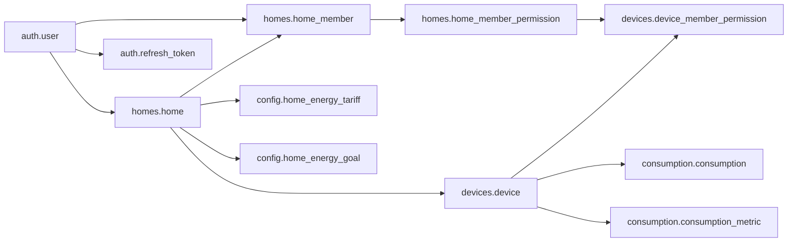

# Modelo relacional de SmartHome

## Cómo leer el modelo

Modelo derivado de dev `6caed6b` y del orden del changelog. No es una introspección de una base instalada. La lectura estática identifica **33 nombres de tabla**, incluida consumption.consumption_default, después de retirar devices.device_type. Las particiones mensuales creadas dinámicamente no se cuentan como tablas ya instaladas.

El [diccionario](diccionario-de-datos.md) recoge 295 columnas declaradas, con los cambios de session_version, revocation_probe_at y presupuesto opcional. Las FK, políticas y revisiones se consultan en sus fuentes; no se copian migraciones.

## Esquemas y responsabilidad

| Esquema | Objetos y responsabilidad |
| --- | --- |
| auth | role, user, recovery_token y refresh_token; identidad, recuperación y familias de sesión |
| homes | home, home_member y home_member_permission; pertenencia y permisos base |
| devices | device, datos técnicos, horarios, telemetría cruda y objetos de pairing/identidad MQTT |
| consumption | Lecturas particionadas y métricas agregadas |
| notifications | Reglas, alertas y notificaciones personales |
| config | Preferencias de usuario, tarifas referenciales y objetivos mensuales |
| sync | Metadata de copias en backup; no ejecuta una copia |
| identity_audit | audit_log con eventos semánticos; presencia de tabla no prueba emisión desde todos los casos de uso |

Fuentes base: [tablas](https://github.com/nataliachala1/smarthome-database/blob/6caed6bdfdcc89105a9f0e221e5b2dc8aad4d878/01_ddl/03_tables/changelog.yaml), [relaciones](https://github.com/nataliachala1/smarthome-database/blob/6caed6bdfdcc89105a9f0e221e5b2dc8aad4d878/01_ddl/04_alter/changelog.yaml) y [evolución](https://github.com/nataliachala1/smarthome-database/blob/6caed6bdfdcc89105a9f0e221e5b2dc8aad4d878/changelog/changelog-master.yaml).

## Relaciones principales

Las flechas indican padre → dependiente según FK. El diagrama es parcial para conservar legibilidad.

Las lecturas y métricas usan FK compuesta (id_device, id_home) hacia devices.device, evitando combinar un dispositivo con un hogar diferente. Las alertas/notificaciones también relacionan contexto de hogar/dispositivo. Fuentes: [consumo](https://github.com/nataliachala1/smarthome-database/blob/6caed6bdfdcc89105a9f0e221e5b2dc8aad4d878/01_ddl/04_alter/004_add_alter_consumption.sql), [notificaciones](https://github.com/nataliachala1/smarthome-database/blob/6caed6bdfdcc89105a9f0e221e5b2dc8aad4d878/01_ddl/04_alter/005_add_alter_notifications.sql).

## Identidad y sesiones

auth."user" tiene correo único mediante LOWER(email), password_hash y estados PENDING, ACTIVE, DEACTIVATED, LOCKED. CHECK exige coherencia de deactivated_at y locked_until; esto no realiza el login ni verifica una contraseña.

recovery_token guarda token_hash, tipo, vencimiento y uso. refresh_token guarda token_hash único, family_id, session_version, expiración, revocación, reemplazo y último uso. Son datos de sesión, no JWT en texto plano. La versión de usuario se añade mediante ALTER y se reconcilia en release 009.

Fuentes: [auth](https://github.com/nataliachala1/smarthome-database/blob/6caed6bdfdcc89105a9f0e221e5b2dc8aad4d878/01_ddl/03_tables/001_create_auth_tables.sql), [refresh](https://github.com/nataliachala1/smarthome-database/blob/6caed6bdfdcc89105a9f0e221e5b2dc8aad4d878/01_ddl/04_alter/012_create_refresh_token_table.sql), [puente de sesión](https://github.com/nataliachala1/smarthome-database/blob/6caed6bdfdcc89105a9f0e221e5b2dc8aad4d878/releases/009_session_schema/001_session_schema.sql).

## Hogares, dispositivos y ciclo de vida

home mantiene created_by y membresías separadas. home_member distingue OWNER/MEMBER/GUEST y PENDING/ACTIVE/REVOKED/LEFT; sus CHECK relacionan aceptación y fin.

device pertenece a un hogar. DEACTIVATED con deleted_at nulo representa desactivación temporal; con deleted_at informado, borrado lógico. El nombre y fabricante tienen reglas de unicidad que cambian durante las migraciones. Release 021 permite reutilizar una identidad física cuando el registro anterior fue eliminado lógicamente, conservando los históricos. Release 023 hace lo equivalente para identidades MQTT ya revocadas.

Fuentes: [hogares](https://github.com/nataliachala1/smarthome-database/blob/6caed6bdfdcc89105a9f0e221e5b2dc8aad4d878/01_ddl/03_tables/002_create_homes_tables.sql), [ciclo de vida](https://github.com/nataliachala1/smarthome-database/blob/6caed6bdfdcc89105a9f0e221e5b2dc8aad4d878/01_ddl/04_alter/010_align_device_lifecycle.sql), [re-pairing físico](https://github.com/nataliachala1/smarthome-database/blob/6caed6bdfdcc89105a9f0e221e5b2dc8aad4d878/releases/021_shelly_device_repairing/001_shelly_device_repairing.sql), [identidad MQTT](https://github.com/nataliachala1/smarthome-database/blob/6caed6bdfdcc89105a9f0e221e5b2dc8aad4d878/releases/023_mqtt_identity_repairing/001_mqtt_identity_repairing.sql).

## Consumo y unidades

consumption.consumption usa watts, kWh y magnitudes eléctricas en NUMERIC; la PK incluye id_consumption y read_at, y la tabla se particiona por rango de read_at. energy_delta_kwh no puede ser negativo; energy_total_kwh puede ser nulo. La DB no calcula automáticamente el delta ni detecta por sí sola reinicios del contador.

consumption_metric permite periodos **hora, dia, semana, mes**, con unicidad por dispositivo/periodo/inicio. El nombre de la tabla no acredita un job activo o actualización instantánea.

Fuente: [tipos, unidades y restricciones](https://github.com/nataliachala1/smarthome-database/blob/6caed6bdfdcc89105a9f0e221e5b2dc8aad4d878/01_ddl/03_tables/004_create_consumption_tables.sql).

## Tarifas y metas de energía

SQL034 añade home_energy_tariff con unit_price_cop_kwh positivo, fecha effective_from y unicidad hogar/fecha. Es una tarifa referencial COP/kWh: no almacena facturas calculadas, impuestos o cargos fijos.

home_energy_goal tiene unicidad hogar/month_start y exige primer día del mes. Después del segundo changeset, monthly_budget_cop puede ser nulo; se requiere al menos uno de monthly_budget_cop o target_kwh, y los valores presentes deben ser positivos. No confundir esta persistencia con una API de facturación ya implementada.

Fuente: [tarifas y metas](https://github.com/nataliachala1/smarthome-database/blob/6caed6bdfdcc89105a9f0e221e5b2dc8aad4d878/releases/034_energy_tariff_budget/001_energy_tariff_budget.sql), [presupuesto opcional](https://github.com/nataliachala1/smarthome-database/blob/6caed6bdfdcc89105a9f0e221e5b2dc8aad4d878/releases/034_energy_tariff_budget/002_energy_goal_optional_budget.sql).

## Objetos sin disponibilidad funcional acreditada

device_schedule, alert_rule, audit_log y sync.backup definen persistencia. No prueban programación de acciones, generación automática de alertas, cobertura total de auditoría o backups activos. No se detectó un modelo de zonas en este historial. device_type se crea y se carga al inicio, pero se elimina en un refactor posterior.

[Seguridad](seguridad-y-permisos.md). [Operación](operacion-y-mantenimiento.md). [Hallazgos](hallazgos-y-pendientes.md).
